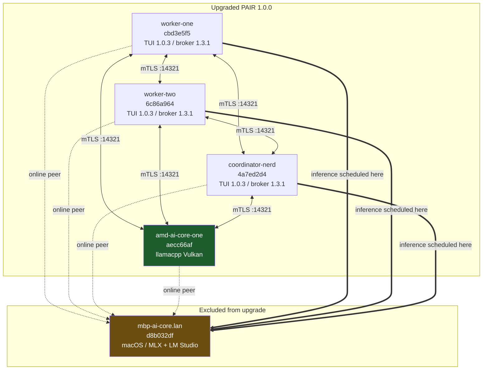

# PAIR 1.0.0 — Final Cluster-Wide Health Report

**Date:** 2026-10-17 (14:00–15:05 BST)
**Validated from:** `turnstone-worker-one` (landed node) + SSH fan-out
**Scope:** `turnstone-worker-one`, `turnstone-worker-two`, `turnstone-coordinator-nerd-projects`, `amd-ai-core-one`
**Excluded:** `mbp-ai-core` (OS/permission blockers — macOS, PAIR owned by `teqonix`, no sudo)
**Cluster ID:** `2f92d942-c857-42c4-a69c-3181d8af920f`
**Verdict:** ✅ **UPGRADE VALIDATED** — all 4 nodes pass all 5 goals. 1 medium-severity host-config defect + 1 medium-severity resilience risk found (neither blocks the upgrade).

---

## 1. Executive Summary

| # | Goal | worker-one | worker-two | coordinator-nerd | amd-ai-core-one |
|---|------|:---:|:---:|:---:|:---:|
| 1 | Version consistency (1.0.0 / broker 1.3.1 / TUI 1.0.3) | ✅ | ✅ | ✅ | ✅ |
| 2 | Unified `nvpair-proxy` on `:1234` + `:11434` | ✅ | ✅ | ✅ | ✅ |
| 3 | Inference returns `PAIR-1.0.0-OK` via `:1234` | ✅ | ✅ | ✅ | ✅ (local models) |
| 4 | Cluster cohesion — all nodes Online | ✅ | ✅ | ✅ | ✅ |
| 5 | AMD Vulkan llama.cpp backend + stable VRAM | n/a | n/a | n/a | ✅ |

All four nodes report **product 1.0.0**, **broker 1.3.1**, **TUI 1.0.3**, **proxy 1.4.0**, with **13/13 files sha256-verified, 0 corrupt, 0 extra**. Zero service restarts. No panic/error artifacts on any node.

---

## 2. Goal 1 — Version Consistency

Verified two ways on every node: the deployed `manifest.json` **and** the binaries' own `--version` output (guards against manifest drift).

`/opt/PAIR/resources/cli-bin/manifest.json` — identical across all 4 nodes:

| Component | Manifest | Binary-reported | Match |
|---|---|---|:---:|
| `product` | `1.0.0` | — | ✅ |
| `nvpair-ui-broker` | `1.3.1` | `1.3.1` | ✅ |
| `nvpair-tui` | `1.0.3` | `1.0.3` | ✅ |
| `nvpair-proxy` | `1.4.0` | `1.4.0` | ✅ |
| `nvpair-cluster-manager` | `1.1.6` | — | ✅ |
| `nvpair-engine-manager` | `0.21.2` | — | ✅ |
| platform / arch | `linux/x64` | — | ✅ |

**Integrity check** (re-hashed every manifest entry against `size` + `sha256`; also flagged stray files):

| Node | ok | bad | extra |
|---|:---:|:---:|:---:|
| worker-one | 13 | 0 | none |
| worker-two | 13 | 0 | none |
| coordinator-nerd-projects | 13 | 0 | none |
| amd-ai-core-one | 13 | 0 | none |

**Old-architecture binaries removed** — pre-1.0.0 `ollama-proxy` / `lmstudio-proxy` are **absent from all 4 live dirs** (`OLD_PROXIES = none`), confirming the 1.0.0 single-proxy cutover is complete everywhere.

**Service state (all 4):** `nvpair.service` → `active` + `enabled`, **`NRestarts = 0`**, no restart loops.

---

## 3. Goal 2 — Unified Proxy

`ss -tlnpH` confirms a **single** `nvpair-proxy` process owns **both** facade ports on every node — the defining 1.0.0 architecture change (old separate proxies are gone).

| Node | `nvpair-proxy` procs | `:1234` owner | `:11434` owner | Same PID? |
|---|:---:|---|---|:---:|
| worker-one | 1 | nvpair-proxy (575978) | nvpair-proxy (575978) | ✅ |
| worker-two | 1 | nvpair-proxy (1132442) | nvpair-proxy (1132442) | ✅ |
| coordinator-nerd-projects | 1 | nvpair-proxy (3913024) | nvpair-proxy (3913024) | ✅ |
| amd-ai-core-one | 1 | nvpair-proxy (2506670) | nvpair-proxy (2506670) | ✅ |

> [!NOTE]
> `amd-ai-core-one` additionally runs a third listener `:8082` owned by the same proxy — the llamacpp engine's proxy port, per its `/home/teqonix/.config/Nvidia Corporation/Personal AI Router/engines/llamacpp.json` override. Expected, not a duplicate-proxy condition.

---

## 4. Goal 3 — Inference Path (`:1234` → `PAIR-1.0.0-OK`)

Test: `POST /v1/chat/completions`, `temperature=0`, prompt *"Reply with exactly: PAIR-1.0.0-OK"*, `max_tokens=400` (budget sized to clear reasoning-token overhead on thinking models).

| Node | Model used | Result | TTFT/total | Scheduled onto |
|---|---|:---:|---|---|
| worker-one | `nvidia-nemotron-3.5-lightning-30b-a3b-optiq` | ✅ `PAIR-1.0.0-OK` | 33 s | `mbp-ai-core` (remote, lmstudio) |
| worker-two | `nvidia-nemotron-3.5-lightning-30b-a3b-optiq` | ✅ `PAIR-1.0.0-OK` | 75 s | `mbp-ai-core` (remote, lmstudio) |
| coordinator-nerd | `nvidia-nemotron-3.5-lightning-30b-a3b-optiq` | ✅ `PAIR-1.0.0-OK` | 75 s | `mbp-ai-core` (remote, lmstudio) |
| amd-ai-core-one | `qwen-3.8-27b` (local Vulkan) | ✅ `PAIR-1.0.0-OK` | 8 s | local `llamacpp` |
| amd-ai-core-one | `gemma-4-26b-a4b` (local Vulkan) | ✅ `PAIR-1.0.0-OK` | 7 s | local `llamacpp` |
| amd-ai-core-one | `gemma-4-31b` (local Vulkan) | ✅ `PAIR-1.0.0-OK` | 10 s | local `llamacpp` |
| amd-ai-core-one | `qwen3.8-27b` (local Vulkan) | ✅ `PAIR-1.0.0-OK` | 8 s | local `llamacpp` |

All 4 nodes return the exact expected string with `finish_reason: stop`. Facade model inventory reachable on all nodes (`/v1/models` → 9 entries on the three Linux workers; 4 on `amd-ai-core-one` — see Anomaly A4).

> [!IMPORTANT]
> The cluster's default fast model **is served by the excluded node** `mbp-ai-core` — see **Anomaly A3**, the most consequential finding in this report.

---

## 5. Goal 4 — Cluster Cohesion

Two independent proofs:

**(a) Shared cluster identity** — all 4 upgraded nodes report the identical `cluster_id` `2f92d942-c857-42c4-a69c-3181d8af920f` and a converged 7-entry roster from `…/Personal AI Router/cluster/members.json` (4 upgraded + `mbp-ai-core.lan` + `litellm-proxy` + `nvidia-pair-ui`). `state = member` for all.

**(b) Full-mesh liveness** — I replicated the TUI's own "Online" determination (HTTP `GET /v1/node-info` on port `14318`) **from each of the 4 upgraded nodes toward all 5 members**, and cross-checked each answering `hostUuid` against the roster's expected UUID. **16/16 cross-node probes ONLINE, 0 UUID mismatches** — every node is seen by every other node with the identity the roster expects.

| Target ↓ / Viewer → | worker-one | worker-two | coordinator-nerd | amd-ai-core-one |
|---|:---:|:---:|:---:|:---:|
| **worker-one** `cbd3e5f5` | self | ✅ | ✅ | ✅ |
| **worker-two** `6c86a964` | ✅ | self | ✅ | ✅ |
| **coordinator-nerd** `4a7ed2d4` | ✅ | ✅ | self | ✅ |
| **amd-ai-core-one** `aecc66af` | ✅ | ✅ | ✅ | self |
| **mbp-ai-core** `d8b032df` (not upgraded) | ✅ | ✅ | ✅ | ✅ |

Note that `mbp-ai-core` participates as a healthy online peer despite being excluded from the upgrade — the cluster tolerates mixed versions on the discovery plane.



---

## 6. Goal 5 — Engine Health: `amd-ai-core-one`

### 6.1 Backend identity — confirmed **real AMD GPU**, not a software fallback

This node ships `libvulkan_lvp.so` (llvmpipe software rasterizer) in the system Vulkan ICD path, so "Vulkan is loaded" alone is **not** proof of hardware acceleration. Four independent proofs:

| Evidence | Result |
|---|---|
| `libggml-vulkan.so` mapped into running `llama-server` | ✅ 6 mappings in PID 2506690 |
| AMD render node open by the process | ✅ `/dev/dri/renderD128` (fd 3 **and** 4) |
| `llama-server --list-devices` enumeration | ✅ `Vulkan0: Radeon 8060S Graphics (RADV GFX1151) (123392 MiB, 104495 MiB free)` |
| Kernel driver / PCI | ✅ `DRIVER=amdgpu`, `PCI_ID=1002:1586` |
| During-load `gpu_busy_percent` ramps to 100% | ✅ real silicon saturating (llvmpipe would not report via amdgpu sysfs) |

Device is the **RADV (Mesa Vulkan) driver on the Strix Halo iGPU** — `GFX1151` is the Strix Halo gfx family. `llvmpipe`/`lvp` was **not** selected.

**llama.cpp build:** `b11146-7fe450e19` (matches the accepted baseline). Topology: a router `llama-server` on `127.0.0.1:8081` (`--models-dir …/aliases --models-max 1 -c 16384 --sleep-idle-seconds 300`) spawning a per-model worker on an ephemeral port (`--alias qwen3.8-27b --ctx-size 16384 --model …/Qwen3.8-27B-Q4_K_M.gguf --mmproj …`). Both `/health` endpoints return `{"status":"ok"}`.

### 6.2 VRAM stability

| State | `mem_info_vram_used` | `gpu_busy_percent` |
|---|---|---|
| Idle, sample 1 | 155,406,336 B | 0% |
| Idle, sample 2 (5 s) | 155,406,336 B | 0% |
| Idle, sample 3 (10 s) | 155,406,336 B | 0% |
| Load ramp (t=1→12 s) | rises then plateaus | 0 → 22 → 69 → 96 → 100% |

**Verdict: stable.** Zero drift across idle samples; no monotonic growth across repeated load/evict cycles; GPU returns to 0% busy at idle.

> [!WARNING]
> **Do not use `mem_info_vram_used` as the capacity metric on this node.** The Strix Halo is a unified-memory APU: sysfs reports only a **512 MiB** carve-out (`mem_info_vram_total = 536870912`) while the real budget is the **123 GiB** unified allocation Vulkan reports (122 GiB total / 102 GiB free). A model that "doesn't fit" in the sysfs number still runs fine. Use `llama-server --list-devices` for authoritative figures.

### 6.3 Idle eviction (`--sleep-idle-seconds 300`)

Working as designed. Worker PIDs turn over between invocations spaced >300 s apart (e.g. `2508438` → `2645564` → `2653754`), i.e. the idle worker is released and a fresh one is spawned on the next request, with `gpu_busy_percent` returning to 0%. Cold reload for `qwen-3.8-27b` (Q4_K_M + BF16 mmproj, 16 K ctx) completes and serves within ~8 s end-to-end.

---

## 7. Anomalies & Findings

Ordered by severity. **None block the upgrade sign-off.**

### A3 — 🔴 MEDIUM (resilience): the default inference path depends on the *excluded* node

Every `:1234` PASS on worker-one, worker-two, and coordinator-nerd was satisfied by scheduling the model onto **`mbp-ai-core`** (`scheduledOn: d8b032df…`, engine `lmstudio`) — the very node excluded from the upgrade. Those three nodes run **no local engine** (`engine-settings-operations.json`: all engines `running: false`, `phase: idle`).

**Impact:** if `mbp-ai-core` goes offline or its PAIR/LM Studio stack stops, **all three upgraded Linux nodes lose their primary inference path**, despite being perfectly healthy. Only `amd-ai-core-one` has a self-contained engine.

**Recommendation:** give at least one of worker-one/worker-two a local engine (the `amd-ai-core-one` llamacpp/Vulkan pattern is proven), or explicitly accept the single-point dependency in writing.

### A1 — 🟠 MEDIUM (host config): `worker-two` `/etc/hosts` points `worker-one` at loopback

On `turnstone-worker-two`, `/etc/hosts` contains:

```
127.0.1.1	turnstone-worker-one.lan	turnstone-worker-one
```

This is **worker-one's own hostname mapping, pasted onto worker-two**. Consequence, proven live: probing `http://turnstone-worker-one.lan:14318/v1/node-info` **from worker-two** resolves to loopback and returns **worker-two's own** UUID (`6c86a964…`) instead of worker-one's (`cbd3e5f5…`).

**Why PAIR still works:** the roster stores **IP addresses** (`192.168.60.238` for worker-one), and the scanner/TUI use those IPs — so the mesh, discovery, and scheduling are unaffected. This is a **hostname-resolution landmine for any other tooling** (monitoring, ad-hoc curl, scripts using `.lan` names) running on worker-two: it will silently talk to the wrong machine and get plausible-looking answers.

**Fix (worker-two, root):**
```bash
# change worker-two's own loopback name; do NOT name worker-one here
sed -i 's/^127\.0\.1\.1\tturnstone-worker-one\.lan\tturnstone-worker-one$/127.0.1.1\tturnstone-worker-two.lan\tturnstone-worker-two/' /etc/hosts
```
Not applied — host-file change outside the validated upgrade scope; needs your go-ahead.

### A2 — 🟡 LOW–MEDIUM: Ollama facade (`:11434`) inventory is not populated

`:11434` is correctly unified and reachable on all 4 nodes, but:
- `GET /api/tags` → `{"error":"model inventory unavailable"}` (all 4 nodes)
- `POST /api/generate` → `"no available node advertises the requested model"` — **even on `amd-ai-core-one` for `qwen-3.8-27b`, which succeeds via `:1234` at the same instant.**

The Ollama-compatible facade's model-inventory projection is empty while the OpenAI-compatible `:1234` facade works. **Impact:** Ollama-native clients (llama.cpp's Ollama integration, LangChain/LlamaIndex Ollama providers, `ollama` CLI pointed at the proxy) cannot list or invoke models. OpenAI-compatible clients are unaffected. Worth an upstream look if Ollama-protocol workloads matter to you.

### A4 — 🟡 LOW: `amd-ai-core-one` `:1234` exposes a different model set than the other three

`/v1/models` returns **9** models on the Linux workers but **4** on `amd-ai-core-one` (`gemma-4-26b-a4b`, `gemma-4-31b`, `qwen-3.8-27b`, `qwen3.8-27b`). This is **by design** for the accepted config — on this node `:1234` is bound to the **llamacpp** facade (local GGUF alias dir), whereas on the other three `:1234` is the **lmstudio** facade showing cluster-wide inventory. Flagged only because it makes the model list node-dependent; a client pointed at `:1234` sees different catalogues per node.

### A5 — ⚪ COSMETIC: Electron desktop shell not upgraded on any node

`/opt/PAIR/nvpair` remains Sep 11 (amd: Aug 28) on all four nodes — these are headless TUI-only deployments, so no functional impact. Revisit only if someone needs the desktop app.

### A6 — ⚪ COSMETIC: `cluster_friendly_name` is `amd-ai-core-one` on all four nodes

`…/Personal AI Router/settings.json` carries `cluster_friendly_name: "amd-ai-core-one"` on every node. This is the **cluster-level** name (shared by design, so consistent), but it coincides with exactly one node's hostname, which reads confusingly in the TUI. Purely presentational.

### A7 — ⚪ COSMETIC: VM nodes report `telemetryValid: false`

worker-one/two/coordinator expose only a `QXL paravirtual graphic card` with no VRAM counters, so GPU telemetry is unavailable on the virtualised nodes. Expected.

---

## 8. Sign-off

| Node | Version | Unified proxy | `:1234` inference | Cohesion | Engine | Overall |
|---|:---:|:---:|:---:|:---:|:---:|:---:|
| `turnstone-worker-one` | ✅ | ✅ | ✅ | ✅ | n/a | ✅ **Healthy** |
| `turnstone-worker-two` | ✅ | ✅ | ✅ | ✅ | n/a | ✅ **Healthy** ⚠ A1 hostfile |
| `turnstone-coordinator-nerd-projects` | ✅ | ✅ | ✅ | ✅ | n/a | ✅ **Healthy** |
| `amd-ai-core-one` | ✅ | ✅ | ✅ ×4 | ✅ | ✅ Vulkan/RADV hw-accelerated | ✅ **Healthy** |

**PAIR 1.0.0 is validated cluster-wide.** The upgrade itself is clean, consistent, integrity-verified, and fully cohesive across all four nodes. Follow-ups, none blocking:

1. **A3** — decide on inference redundancy (3 nodes currently ride on the excluded `mbp-ai-core`).
2. **A1** — fix `worker-two:/etc/hosts` (one-liner above; needs root approval).
3. **A2** — investigate empty Ollama-facade inventory if Ollama-protocol clients are in scope.

---

## Appendix — Validation Artifacts

Read-only probe scripts (no mutations performed during validation):

| Path | Purpose |
|---|---|
| `/workspace/nvidia-pair-teqonix/.deploy_tmp/validation/node_probe.sh` | Per-node: manifest + binary versions, sha256 integrity, old-proxy absence, unified-proxy PID/port check, systemd state, `:1234` inference assertion, engine/roster dump |
| `/workspace/nvidia-pair-teqonix/.deploy_tmp/validation/cohesion.sh` | Cohesion via `.lan` hostnames (surfaced anomaly A1) |
| `/workspace/nvidia-pair-teqonix/.deploy_tmp/validation/cohesion_ip.sh` | Cohesion via **roster IPs** + `hostUuid` cross-check (authoritative mesh proof) |

Config roots inspected:
- `/home/turnstone/.config/Nvidia Corporation/Personal AI Router/` (worker-one, worker-two, coordinator-nerd-projects)
- `/home/teqonix/.config/Nvidia Corporation/Personal AI Router/` (amd-ai-core-one — PAIR runs as `teqonix` here; read via `sudo`)
