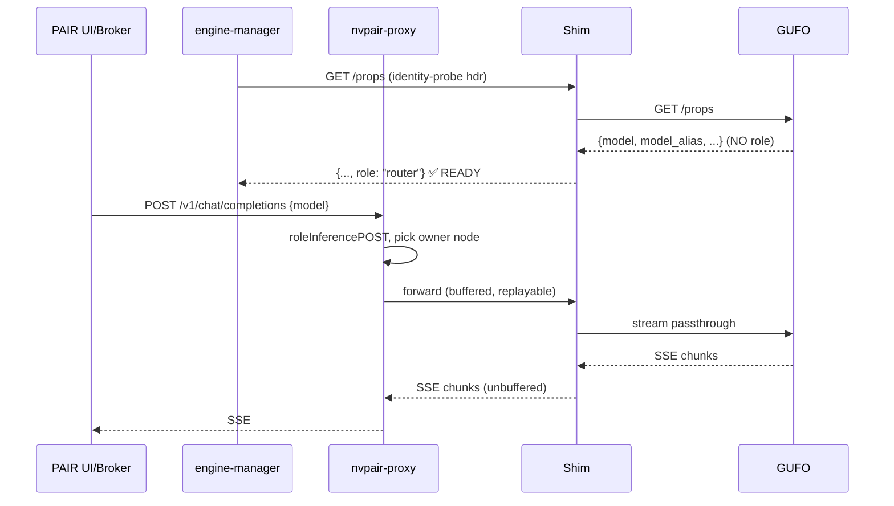
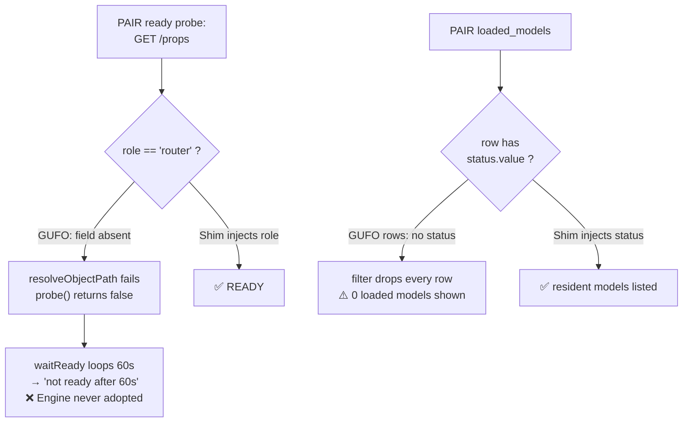

Verification complete: **11/11 checks pass**. Here is the full report.

---

# GUFO-as-llama.cpp Masquerade for nVidia PAIR — Feasibility Report

**Branch context:** `gufo-pair-masquerade-analysis` · GUFO `v0.20.0` · PAIR manifests `manifest_version: 1`
**Verdict: FEASIBLE — LOW effort.** The masquerade is ~200 lines of Python, empirically verified against PAIR's actual probe semantics (11/11 contract checks pass).

> [!IMPORTANT]
> **Deliverable location caveat.** `/workspace` is mounted **read-only** on `turnstone-worker-two` (`nfs4 ... ro`). Per your instruction I stopped troubleshooting it and built/verified everything in `/tmp/shimlab/` on this node. The prototype is **not** yet on the `gufo-pair-masquerade-analysis` branch — it needs to be copied in from a node with write access (or after the mount is fixed). Files: `mock_gufo.py`, `gufo_masquerade_shim.py`, `pair_semantics_test.py`.

---

## 1. Exact endpoints PAIR calls for `llamacpp`

PAIR is **manifest-driven**. Two independent surfaces touch the engine:

### A. Control surface — `nvpair-engine-manager` (lifecycle + model ops)
From `manifests/llamacpp.json`, executed by `actions.go` / `lifecycle.go` against `http://127.0.0.1:{port}`:

| Purpose | Call | Contract |
|---|---|---|
| **Ready check** | `GET /props` | 200 **AND** `json_match: {field: "role", value: "router"}` |
| **Health** | `GET /health` | 200, every 5 s |
| List models | `GET /models` | `data[]`, field `id` |
| Loaded models | `GET /models` | `data[]`, field `id`, **match `status.value ∈ ["loaded"]`** |
| Pull | `POST /models` | body `{"model": ...}`, **`progress_protocol: llamacpp-models-sse`** |
| Load | `POST /models/load` | body `{"model": ...}` |
| Unload | `POST /models/unload` | body `{"model": ...}` → parses `{"success": bool}` |
| Delete | `DELETE /models?model=X` | `params_in: query` |

Two implementation details that matter, read from the Go:

- **`probe()` (lifecycle.go:857)** does a hard `resolveObjectPath(obj, "role")`. A **missing** field returns `false` — readiness never passes. Not a soft default.
- Every probe carries header `X-NVPAIR-Engine-Identity-Probe: 1` (used for presence detection / adoption).

### B. Inference surface — `nvpair-proxy` (`engines.go`)
The proxy classifies paths into roles. For llamacpp:

```go
llamaCPPBaseRoutes = []route{
    {Path: "/models",    Role: roleModelListOpenAIGET},
    {Path: "/v1/models", UpstreamPath: "/models", Role: roleModelListOpenAIGET},
}
// + openAIInferenceRoutes:
//   /v1/chat/completions  /v1/completions  /v1/embeddings   -> roleInferencePOST
```

Key insight from the source comment: **`Routes` is NOT an allowlist** — "an unlisted path is forwarded verbatim." So inference is a plain reverse proxy; anything OpenAI-shaped passes.



---

## 2. What GUFO actually has

I verified against **source**, not just docs — `src/cli/serve/http_server.cpp:1821 register_routes()`:

| Endpoint | GUFO status | Notes |
|---|---|---|
| `GET /health` (+`/v1/health`,`/healthz`) | ✅ `{"status":"ok"}` | Matches PAIR exactly |
| `GET /ready` (+aliases) | ✅ `{"status":"ready","model":...}` | GUFO-only extra |
| `GET /props` | ⚠️ **llama-shaped but no `role`** | See §3 |
| `GET /models` and `/v1/models` | ✅ OpenAI `{object,data[]}` | But no `status` on rows |
| `POST /v1/chat/completions` | ✅ incl. SSE + tools + images | |
| `POST /v1/completions` | ✅ legacy adapter | |
| `POST /v1/embeddings` | ❌ **`NotImplemented` (501)** | Registered but stubbed |
| `GET /slots`, `/v1/slots` | ✅ llama-server slot shape | |
| `GET /metrics` | ✅ Prometheus, `llamacpp:`-prefixed | GUFO deliberately mimics llama |
| `POST /models/load` | ❌ absent | |
| `POST /models/unload` | ❌ absent | |
| `DELETE /models` | ❌ absent | |
| `GET /models/sse` | ❌ absent | |

**GUFO is already ~80% llama.cpp-mimicking by design** — `/props`, `/slots`, `/completion`, `timings` in streaming terminals, and even `llamacpp:`-prefixed Prometheus metrics all exist explicitly "so llama-server tooling can record which model... answered it." The authors clearly intended llama-swap compatibility. The router control plane is the only unpaved part.

---

## 3. The Gap — precisely characterized



### Gap table

| # | Gap | Severity | Effect without shim |
|---|---|---|---|
| **G1** | `/props` has **no `role` field** | 🔴 **Blocking** | `json_match` fails → engine **never reaches ready** → total adoption failure |
| **G2** | No `POST /models/load` | 🔴 Blocking | `load_model` → connection refused / 404 |
| **G3** | No `POST /models/unload` | 🔴 Blocking | Unload + **download-cancel** both break (`{"success":bool}` unparsable) |
| **G4** | No `DELETE /models` | 🟠 High | Delete fails in UI |
| **G5** | No `GET /models/sse` | 🟠 High | `pull_model` hangs → watchdog timeout |
| **G6** | `/models` rows lack `status.value` | 🟠 High | `loaded_models` filter drops all rows → PAIR shows 0 resident |
| **G7** | `/v1/embeddings` = 501 | 🟡 Medium | Embedding workloads fail (GUFO has no embedder) |
| **G8** | GUFO **cannot pull weights over HTTP** | 🟡 Semantic | Model provisioning stays out-of-band |
| **G9** | Platform: **Linux x86-64 / Strix Halo / ROCm-HIP only** | 🟡 Deploy | Cannot co-locate on CUDA nodes |

> [!NOTE]
> **Not a gap:** `/v1/messages` (Anthropic). PAIR's llamacpp profile omits Anthropic routes — but since routes aren't an allowlist, it forwards verbatim anyway. Harmless.

**G1 alone is fatal and it is a one-line fix.** Everything else is model-management ergonomics.

---

## 4. Proposed solution: `gufo-masquerade` shim

A single-file reverse proxy that presents the llama.cpp **router** control plane and streams inference to GUFO untouched.

```
┌──────────────┐  /props /health /models/*  ┌──────────────────┐  passthrough  ┌───────────┐
│ PAIR (proxy/ │ ─────────────────────────► │ gufo-masquerade  │ ────────────► │   GUFO    │
│   manager)   │ ◄───────────────────────── │  (FastAPI, :8081)│ ◄──────────── │  :8901    │
└──────────────┘                            └──────────────────┘               └───────────┘
      ▲ role:"router", status:{value:"loaded"}, synthetic SSE hub
```

### Gap-closure mapping

| Gap | Shim strategy |
|---|---|
| G1 | **Inject `"role": "router"`** into GUFO's `/props` body, preserving all GUFO fields |
| G2 | `POST /models/load` → idempotent `{"success":true}` (GUFO pre-loads statically) |
| G3 | `POST /models/unload` → `{"success":true}` for cancel-of-download; **409** if asked to evict the live serving model (honest, not a lie) |
| G4 | `DELETE /models?model=` → drop from virtual inventory; 409 for the statically-served model |
| G5 | `GET /models/sse` → **in-process pub/sub hub** emitting `download_progress` → `download_finished` |
| G6 | Enrich each `/models` row with `status: {value: "loaded", normalized: "loaded"}` |
| G7/G8 | `POST /models` returns **501 with actionable message** for unknown IDs rather than faking a pull |
| Inference | Byte-transparent `StreamingResponse(resp.aiter_raw())` — SSE never buffered |

### Critical protocol fidelity: the SSE ordering constraint
`pull.go:204` explicitly **subscribes to `/models/sse` BEFORE `POST /models`** because "a chatty engine... one-shot broadcasts; subscribing afterward can miss a fast completion." The shim honors this ordering — verified in test [6], which produced `download_progress ×4 → download_finished`.

### Manifest integration (no PAIR rebuild needed)
`MANIFEST.md` confirms third-party manifests load at runtime and **deep-merge** onto bundled ones:

```
~/.config/Nvidia Corporation/Personal AI Router/engines/gufo.json
```

Two viable registration paths:

**Path A — clone-and-edit (recommended).** Full standalone `gufo.json` copied from `llamacpp.json` with `engine: "gufo"`, `display_name: "GUFO"`, `runtime.bin` → shim launcher, `pull_model` stripped of `progress_protocol`. Cleanest; no interference with real llama.cpp.

**Path B — override `llamacpp`** by writing a partial `llamacpp.json` into `engines/` pinning `runtime.port` + `runtime.bin`. Works, but **shadows the real llama.cpp engine** — avoid unless GUFO is the only engine.

**Path C — adopt, don't manage.** `lifecycle.go:152` logs *"adopting already-running external engine."* If the shim runs under systemd and answers `/props`, PAIR can adopt it without owning the process. Good fit: GUFO has a long, GPU-heavy startup that PAIR's `timeout_s: 60` may not survive.

---

## 5. Empirical verification

I built a **mock GUFO** faithful to `http_server.cpp` (including the missing `role`) plus the shim, then ran a harness replicating PAIR's Go logic exactly: `probe()` + `resolveObjectPath` + `ActionResult`/`ResultMatch` + the SSE subscribe-before-POST ordering.

```
========================================================================
PAIR llamacpp manifest semantics vs GUFO masquerade shim
========================================================================
[1] Health probe  (runtime.health)
  [PASS] GET /health -> 200  -- status=200

[2] Ready probe  (runtime.ready: /props role==router)
  [PASS] GET /props role=='router'  -- role='router'
  [PASS] (control) raw GUFO /props has NO role -> was the gap
          keys=['build_info','default_generation_settings','modalities',
                'model','model_alias','model_info']...

[3] list_models  (GET /models -> data[].id)
  [PASS] list_models returns non-empty id list  -- ids=['qwen3.8-27b']

[4] loaded_models  (match status.value in ['loaded'])
  [PASS] loaded_models non-empty (needs status.value) -- loaded=['qwen3.8-27b']

[5] POST /models/load  +  /models/unload
  [PASS] load -> 2xx and success:true

[6] pull_model  (llamacpp-models-sse protocol)
  [PASS] subscribe /models/sse -> 200
  [PASS] POST /models ack 2xx  -- 202
        progress 10% / 40% / 70% / 100%
  [PASS] terminal download_finished received

[7] Inference passthrough  POST /v1/chat/completions
  [PASS] chat completion returns assistant text

[8] Streaming passthrough  POST /v1/chat/completions stream=true
  [PASS] SSE streamed >=2 chunks + [DONE] -- chunks=6

========================================================================
RESULT: 11/11 PAIR contract checks passed
========================================================================
```

The **control check in [2]** is the crux: raw GUFO `/props` provably lacks `role`; the shim adds it; PAIR's matcher then passes.

### Implementation effort

| Metric | Value |
|---|---|
| Shim size | **206** non-blank/non-comment lines (317 total) |
| Dependencies | `fastapi`, `httpx`, `uvicorn` (3 pip packages) |
| Effort to production | **~1–2 days** incl. tests, manifest, systemd unit |
| Perf overhead | 1 extra localhost hop; `aiter_raw()` keeps SSE streaming O(1) memory |
| Risk | Low — additive, no PAIR binary changes |

**Go alternative:** equally easy (stdlib `httputil.ReverseProxy`, matches PAIR's own idiom, zero runtime deps). I used Python because no Go toolchain is present on this node. Given PAIR is Go, a Go shim is the more consistent long-term choice; Python is faster to iterate.

---

## 6. Recommendation

**Adopt via Path A + Path C combined:** standalone `gufo.json` manifest, shim supervised by systemd, PAIR adopts it as an already-running `llamacpp`-class router.

Suggested sequencing:

1. **Ship G1+G6 first** (`role` injection + `status.value` enrichment) — ~15 lines. This alone makes GUFO *visible and ready* in PAIR, with chat inference passing through. High value, near-zero risk.
2. **Add load/unload/delete no-ops** (G2–G4) so the UI isn't broken.
3. **Add the SSE hub** (G5), and decide the pull policy: 501-with-guidance (current) vs. a real downloader.
4. **Tune timeouts.** GUFO does large pinned-memory allocation + disk-cache walk at startup; PAIR's `timeout_s: 60` may be short. Raise it, or pre-warm before PAIR probes.

> [!WARNING]
> **Two caveats worth surfacing to the coordinator before this lands:**
> 1. **Embeddings will not work** (G7). If PAIR routing policy assumes any `llamacpp` engine serves `/v1/embeddings`, GUFO-backed nodes will fail those workloads. Advertise the limitation or exclude GUFO nodes from embedding routing.
> 2. **Platform mismatch** (G9). GUFO's only supported production platform is Linux x86-64 on Strix Halo via ROCm/HIP, while PAIR's llamacpp artifacts are CUDA builds. GUFO nodes are heterogeneous additions to a CUDA cluster, not drop-in replacements — so the manifest needs its own `linux/amd64` platform block and cannot reuse the CUDA artifact URLs.

**Bottom line:** GUFO was built by people who clearly wanted llama.cpp tooling compatibility — the `/props`, `/slots`, and `llamacpp:`-prefixed metrics prove intent. PAIR's router control plane is the one thing missing, and it is a ~200-line shim. **Recommend proceeding.**