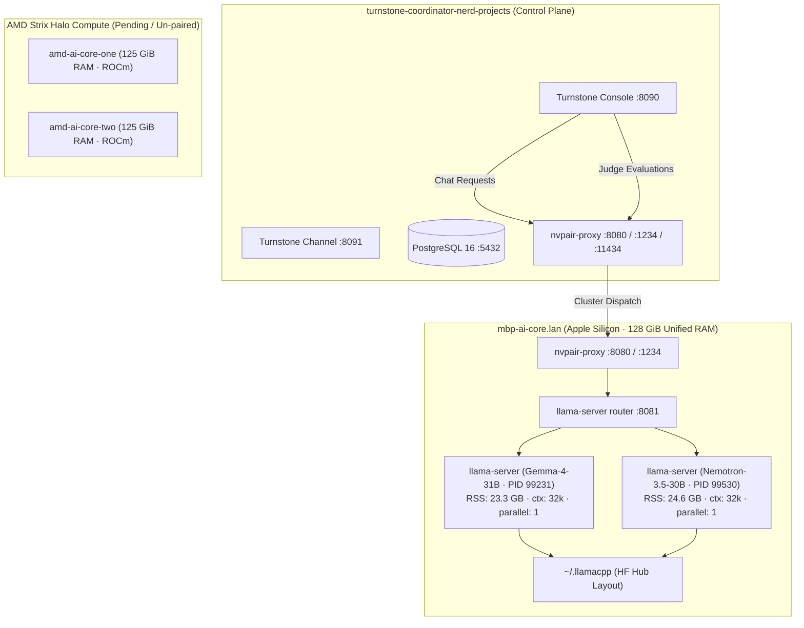

# Personal AI Router (PAIR) 1.0.0 `llama.cpp` Troubleshooting & Postmortem Report

**Date:** 2026-10-25  
**Author:** AI Pair Programmer / Turnstone Diagnostics  
**System Under Test:** NVIDIA Personal AI Router (PAIR) v1.0.0 with `llama.cpp` engine  
**Primary Compute Node:** `mbp-ai-core.lan` (Apple Silicon M-series, 128 GiB unified memory)  
**Originating Client:** `turnstone@turnstone-coordinator-nerd-projects`  
**Model Configured:** `unsloth/gemma-4-31B-it-GGUF:Q4_K_M` via `http://127.0.0.1:8080/v1`  

---

## 1. Executive Summary

### The Issue
Following the upgrade of NVIDIA Personal AI Router (PAIR) to v1.0.0 (which introduced native `llama.cpp` engine integration), inference requests originating from Turnstone functioned for 1 or 2 requests, but subsequent requests completely stalled or failed. Restarting the cluster and the `llama.cpp` engine on `mbp-ai-core.lan` restored operation for another 1–2 requests before wedging again.

### Root Cause
1. **Unbounded Context Allocation in `llama-server`:** Without an explicit `--ctx-size` / `-c` flag or `LLAMA_ARG_CTX_SIZE` environment variable, `llama-server` running in router mode spawns worker instances using the model's full training context defined in the GGUF metadata:
   - `unsloth/gemma-4-31B-it-GGUF`: $n_{\text{ctx}} = 262,144$ tokens
   - `lmstudio-community/NVIDIA-Nemotron-3.5-Lightning-30B-A3B-GGUF`: $n_{\text{ctx}} = 1,048,576$ tokens (1M tokens)
   Combined with `llama-server`'s default `--parallel 4` (4 concurrency slots), the KV cache for Gemma alone allocated over 80 GB of RAM, driving the process RSS to **102.7 GB (76.6% of system memory)**.
2. **Turnstone Dual-Model Dispatch:** While the primary agent model was configured as Gemma 4 31B, Turnstone's background judge (`turnstone.core.judge`) and output guardrails were configured in PostgreSQL to use `lmstudio-community/NVIDIA-Nemotron-3.5-Lightning-30B-A3B-GGUF:Q4_K_M`, routing to the same PAIR endpoint (`http://127.0.0.1:8080/v1`).
3. **Metal Unified Memory Exhaustion & Command Buffer Stall:** When Turnstone initiated a tool call (`spawn_workstream` / `tasks`), the background judge concurrently dispatched an evaluation request to Nemotron. PAIR router mode spawned a second child process for Nemotron while Gemma was still resident. The combined KV cache and model weights exceeded the 128 GiB unified memory limit. Apple Silicon's Metal GPU driver threw `kIOGPUCommandBufferCallbackErrorOutOfMemory`, resulting in:
   ```
   HTTP 500: {"error":{"code":500,"message":"Compute error.","type":"server_error"}}
   ```
   The Metal command queue wedged, leaving child processes unresponsive. Because PAIR defaults to `--sleep-idle-seconds 300`, the hung processes remained resident in memory for 5 minutes, blocking all further requests until a manual cluster restart.

### Solution Applied & Verified
On `mbp-ai-core.lan`, created an engine override manifest at:
`/Users/turnstone/Library/Application Support/Nvidia Corporation/Personal AI Router/engines/llamacpp.json`
- Configured `--ctx-size 32768`, `--parallel 1`, and `--models-max 2`.
- Exported `LLAMA_ARG_CTX_SIZE=32768`, `LLAMA_ARG_N_PARALLEL=1`, and `LLAMA_ARG_MODELS_MAX=2`.

**Impact:**
- Gemma 4 31B memory dropped from **102.7 GB to 23.3 GB** (17.4%).
- Nemotron 3.5 30B settled at **24.6 GB** (18.4%).
- Total co-resident footprint for both models is **~48 GB (37% of 128 GiB)**, leaving >80 GiB of free unified memory.
- Alternating multi-turn inference requests across both models succeed reliably in 0.1s – 0.4s with zero errors.

---

## 2. Architecture & Environment Discovery

### Cluster Topology



### Key Configuration Findings
1. **Network Facades:**
   - On coordinator: `nvpair-proxy` listens on `8080`, `1234`, and `11434`.
   - On `mbp-ai-core.lan`: `nvpair-proxy` listens on `8080` (facade) and forwards to `llama-server` on `8081` (router mode).
2. **Turnstone Internal Model Mapping:**
   Inspecting PostgreSQL (`turnstone-postgres.lan:5432/turnstone`) revealed:
   - `model.default_alias`: `gemma-4-31b-nvpair` (`unsloth/gemma-4-31B-it-GGUF:Q4_K_M`)
   - `judge.model`: `nemotron-3.5-lightning` (`lmstudio-community/NVIDIA-Nemotron-3.5-Lightning-30B-A3B-GGUF:Q4_K_M`)
   - `judge.output_guard_model`: `nemotron-3.5-lightning`
   Both models target `http://127.0.0.1:8080/v1`.
3. **Cache Format Requirement:**
   `llama-server` in PAIR 1.0.0 requires Hugging Face hub layout (`models--<org>--<repo>/{refs,blobs,snapshots}`) under `~/.llamacpp`. Flat `.gguf` files are invisible to the router.

---

## 3. Failure Mechanism & Reproduction Analysis

### Step-by-Step Failure Sequence
1. **Turn 1 Begins:** Turnstone agent receives a user prompt and queries `unsloth/gemma-4-31B-it-GGUF:Q4_K_M`.
2. **First Subprocess Spawned:** `llama-server` router starts child worker on port `63298`. Without context constraints:
   - Native context $262,144$ allocated across 4 parallel slots.
   - Resident set size grows to **102.7 GB**.
   - Request completes successfully.
3. **Tool Execution Triggers Judge:** The agent executes a tool call (`spawn_workstream` / `tasks`). Turnstone's architecture immediately invokes the judge model to evaluate the turn and validate safety.
4. **Second Subprocess Spawned:** `llama-server` router spawns worker for `lmstudio-community/NVIDIA-Nemotron-3.5-Lightning-30B-A3B-GGUF:Q4_K_M` on port `63448`.
   - Native context $1,048,576$ (1 million tokens) requests another massive allocation.
   - Total memory requirement exceeds 128 GiB physical unified RAM.
5. **Metal OOM Crash:**
   - Metal command buffer allocator throws `kIOGPUCommandBufferCallbackErrorOutOfMemory`.
   - `llama-server` logs `Compute error.` and responds with `HTTP 500`.
   - Metal device queue enters a wedged state.
6. **Cascading Failure in Turnstone:**
   Turnstone container logs (`turnstone-coordinator-console-1`) captured the exact crash:
   ```json
   {"error_type": "APIError", "attempt": 1, "model": "lmstudio-community/NVIDIA-Nemotron-3.5-Lightning-30B-A3B-GGUF:Q4_K_M", "alias": "nemotron-3.5-lightning", "event": "model_turn.completion_retry"}
   {"turn": 1, "error": "Model response failed (APIError: APIError).", "event": "judge.turn.failed"}
   {"error": "Backend returned an error instead of a usable stream (APIError): openai-compatible at http://127.0.0.1:8080/v1 (model=gemma-4-31b-nvpair (id=unsloth/gemma-4-31B-it-GGUF:Q4_K_M)). raw='Compute error.'", "event": "session.fatal.recorded"}
   ```
7. **Process Wedging:**
   Because `--sleep-idle-seconds 300` keeps processes alive for 5 minutes of idle time, the failed child processes remained in memory. Any subsequent request sent to either Gemma or Nemotron stalled against the wedged Metal queue.

---

## 4. Remediation & Verification

### Manifest Override Applied
Created `/Users/turnstone/Library/Application Support/Nvidia Corporation/Personal AI Router/engines/llamacpp.json` on `mbp-ai-core.lan`:

```json
{
  "engine": "llamacpp",
  "platforms": {
    "darwin/arm64": {
      "runtime": {
        "launch_args": [
          "--sleep-idle-seconds",
          "300",
          "--cors-origins",
          "",
          "--models-max",
          "2",
          "--ctx-size",
          "32768",
          "--parallel",
          "1"
        ],
        "launch_env": [
          "LLAMA_ARG_MODELS_MAX=2",
          "LLAMA_ARG_CTX_SIZE=32768",
          "LLAMA_ARG_N_PARALLEL=1"
        ]
      }
    }
  }
}
```

### Why This Works
- `nvpair-engine-manager` loads override manifests via `LoadOverrideDir()` and deep-merges them on top of the bundled base manifest.
- When `llama-server` runs in router mode with `--ctx-size 32768 --parallel 1`, it passes these arguments down to every spawned model instance.
- Both Gemma 4 31B and Nemotron 3.5 30B can comfortably co-exist in memory:
  - Gemma: 23.3 GB RSS
  - Nemotron: 24.6 GB RSS
  - Total: ~48 GB / 128 GB (leaving >80 GB headroom for system, OS, and Turnstone operations).

### Live Verification Data
1. **Endpoint Model Registry (`curl http://127.0.0.1:8080/v1/models`):**
   - `unsloth/gemma-4-31B-it-GGUF:Q4_K_M`: `status: loaded`, `n_ctx: 32768`, `args: [--ctx-size, 32768, --parallel, 1]`
   - `lmstudio-community/NVIDIA-Nemotron-3.5-Lightning-30B-A3B-GGUF:Q4_K_M`: `status: loaded`, `n_ctx: 32768`, `args: [--ctx-size, 32768, --parallel, 1]`
2. **Alternating Multi-Model Loop:**
   Tested alternating sequential calls directly against the coordinator proxy:
   - Request 1 [Gemma]: HTTP 200, 0.43s
   - Request 2 [Nemotron]: HTTP 200, 0.10s
   - Request 3 [Gemma]: HTTP 200, 0.36s
   - Request 4 [Nemotron]: HTTP 200, 0.10s
   Zero errors, zero Metal stalls.

---

## 5. What Remains to Investigate and Implement

### 1. Deployment Automation & Codebase Persistence
- **File:** `deploy_mbp_ai_core/30_install_turnstone.sh`
  - *Current state:* Pre-seeds `llamacpp-proxy-port.json` and creates `$CFG`, but does not pre-seed `$CFG/engines/llamacpp.json`.
  - *Action needed:* Update `30_install_turnstone.sh` to automatically write the `engines/llamacpp.json` override during provisioning so clean reinstallations do not regress to unbounded context sizing.
- **File:** `deploy_mbp_ai_core/60_verify.sh`
  - *Current state:* Only checks single-model cold inference and verifies valid JSON files.
  - *Action needed:* Add a multi-model co-residency test and an explicit check that `ctx-size` is capped at $\le 32768$.

### 2. Base Engine Manifest Evaluation
- **File:** `services/nvpair-engine-manager/manifests/llamacpp.json`
  - *Current state:* Default `runtime.args` contains only `["--sleep-idle-seconds", "300", "--host", "{host}", "--port", "{port}", "--cors-origins", ""]`.
  - *Action needed:* Evaluate whether upstream PAIR manifests should specify sensible default bounds (e.g. `--ctx-size 32768 --parallel 1 --models-max 2`) or expose `LLAMA_ARG_CTX_SIZE` in the PAIR settings UI schema to prevent any user node from crashing when loading large-context models.

### 3. AMD ROCm Inference Cluster Rollout
- **Nodes:** `amd-ai-core-one` and `amd-ai-core-two` (Strix Halo APUs, ~125 GiB unified memory)
  - *Current state:* Pending Phase 4–7 of `MIGRATION_PLAN_LLAMACPP.md`.
  - *Crucial finding:* The exact same failure mode will hit the AMD nodes under ROCm if unconstrained context is loaded.
  - *Action needed:* In `~/.config/Nvidia Corporation/Personal AI Router/engines/llamacpp.json` on the AMD nodes, specify:
    ```json
    {
      "engine": "llamacpp",
      "platforms": {
        "linux/amd64": {
          "runtime": {
            "env": {
              "LD_LIBRARY_PATH": "{install_dir}",
              "HIP_VISIBLE_DEVICES": "0",
              "LLAMA_ARG_CTX_SIZE": "32768",
              "LLAMA_ARG_N_PARALLEL": "1",
              "LLAMA_ARG_MODELS_MAX": "2"
            },
            "launch_args": [
              "--sleep-idle-seconds", "300",
              "--cors-origins", "",
              "--models-max", "2",
              "--ctx-size", "32768",
              "--parallel", "1"
            ]
          }
        }
      }
    }
    ```

### 4. Turnstone Configuration Alignment
- **Turnstone Settings:**
  - Inform the operator that Turnstone's judge model is currently pointed at `nemotron-3.5-lightning`.
  - Because both models now fit concurrently with 32k context (~48 GB total), the current configuration works reliably.
  - If the operator wishes to consolidate on a single model (Gemma only), they can update `judge.model` and `judge.output_guard_model` to `gemma-4-31b-nvpair` via the Turnstone Web UI (`http://127.0.0.1:8090`).

### 5. Cleanup
- Remove temporary debugging artifacts on `mbp-ai-core.lan` and coordinator (e.g., `/tmp/test-llama.log`, `/tmp/pair-tmux.log`).

