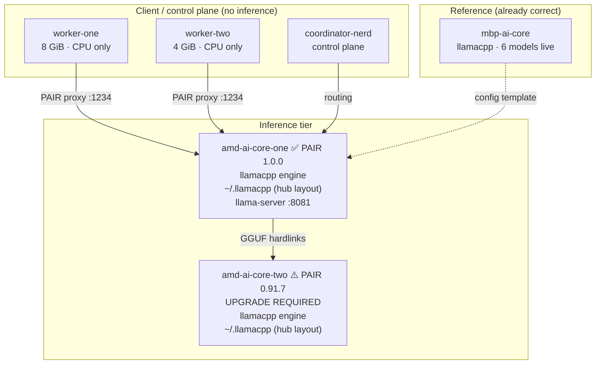
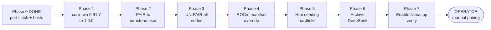

# Migration Plan: PAIR-Managed Inference on `llama.cpp` (ROCm, `turnstone` user, un-paired)

**Author:** turnstone-worker-two (session 8009dcd8…) · **Date:** 2026-10-20 · **Updated:** 2026-10-21
**Scope:** Replace LM Studio as the PAIR-managed engine with `llama.cpp` across the cluster.
**Status:** Phases 1–3 **DONE** (all nodes on 1.0.0, running as `turnstone`, un-paired). Phases 4–7 (ROCm `llama.cpp` engine + hub seeding + DeepSeek archive) **pending.** See §15 execution log.

---

## 0. Operator decisions (2026-10-20)

| # | Decision | Consequence |
|---|---|---|
| 1 | **ROCm backend** on the AMD nodes for peak Strix Halo performance | **No source build needed** — the published `b11146` ROCm binary is verified working on this hardware (§6.1). Integrated via PAIR's manifest override, not system packages. |
| 2 | **Run PAIR as `turnstone`**, not `teqonix` — matches `mbp-ai-core` | Unit `User=`/`Group=`/`HOME=` change + config-dir move. Lemonade is **left alone** (mutually exclusive with PAIR-managed inference). |
| 3 | **DeepSeek-V4-Flash Q8_K_XL: archive**, don't delete | Same-volume archive ⇒ instant, zero extra disk (hardlinks). Kept for future hardware. |
| 4 | **Do NOT create a new cluster.** Un-pair every node; confirm each runs PAIR `1.0.0` clean | Cluster creation is **manual, by the operator.** This plan stops at "every node un-paired and healthy on 1.0.0". |
| 5 | Re-use the **container build / inode-preserving `cli-bin` swap** for `core-two` | Proven on worker-one / worker-two. |
| 6 | `mbp-ai-core` keeps its existing `llamacpp` engine serving GGUF | **MLX is not compatible with `llama.cpp`** — see §2.1. |

> [!WARNING]
> **The MLX assumption conflicts with reality** — see §2.1. The ROCm decision, by contrast, turned out **easier** than expected: no source build is required (§6.1, verified live on `amd-ai-core-one` 2026-10-20).

---

## 1. Executive summary

| Question | Answer |
|---|---|
| Can existing models be hosted by `llama.cpp`? | **Yes — almost all are already GGUF.** No HF re-download needed for the bulk. |
| What is actually blocking? | (a) `amd-ai-core-two` is still PAIR **0.91.7** with **zero** `llamacpp` support; (b) stock `llamacpp.json` ships **CUDA-only** Linux builds — fixed via PAIR manifest override with the verified ROCm build (§6.1); (c) GGUFs are in **flat dirs**, which `llama-server` cannot see. |
| Can the workers host models? | **No.** `worker-one`/`worker-two` are CPU-only VMs with 4–8 GiB RAM. They are router members/clients only. |
| Biggest single risk | The **hub-layout** requirement. A directory of `.gguf` files is **invisible** to `llama-server` — it reports `cache: 0`. |

> [!IMPORTANT]
> Three findings contradict the assumptions in `UPGRADE_PLAN_1_0_0.md`:
> 1. It assumes GGUFs "must be explicitly provisioned" — true, but it does not state they must be in **HF hub layout**, which is the actual failure mode.
> 2. It lists `amd-ai-core-two` as a "Standard Upgrade" — it is **not** on 1.0.0, and is the only node with no `llamacpp` engine code at all.
> 3. It implies workers participate in inference — they **cannot** (CPU-only, ≤8 GiB RAM).

---

## 2. Verified per-node state

| Node | PAIR | `llamacpp` in engine-manager | RAM | GPU | GGUF on disk | Verdict |
|---|---|---|---|---|---|---|
| `amd-ai-core-one` | **1.0.0** | ✅ present (0.21.2) | 125 GiB | Radeon 8060S (Strix Halo) | **431.7 GiB / 29 files** | **Primary inference host** |
| `amd-ai-core-two` | ⚠️ **0.91.7** | ❌ **zero strings** | ~125 GiB | Strix Halo | 29 files | **Must upgrade to 1.0.0 first** |
| `turnstone-worker-one` | 1.0.0 | ✅ present | **8 GiB** | none (QXL virt) | 0 | Member / client only |
| `turnstone-worker-two` | 1.0.0 | ✅ present | **4 GiB** | none (QXL virt) | 0 | Member / client only |
| `mbp-ai-core.lan` | 1.0.0 | ✅ **proven live** | — | Apple Silicon | 6 models | **Reference implementation** |
| `coordinator-nerd-projects` | 1.0.0 | ✅ present | — | — | 0 | Control plane only |

> [!NOTE]
> `mbp-ai-core` already runs exactly the target architecture (`llamacpp` engine, hub-layout cache, 6 models on `:1234`). **Use it as the golden reference** — diff its working config against the AMD nodes rather than inventing new configuration.

### 2.1 ⚠️ Correction: `llama.cpp` cannot host MLX models

> [!CAUTION]
> **MLX and GGUF are different, incompatible model formats.** `llama.cpp` runs **GGUF only**. It has no MLX loader and no code path to one. MLX models run on the `mlx_lm` / MLX framework via Metal, and are Apple-Silicon-exclusive.
>
> Verified on `mbp-ai-core`:
> - MLX weights **do** exist on disk: `~/.lmstudio/models/lmstudio-community/Qwen3.8-27B-MLX-4bit`, `gemma-4-31B-it-MLX-4bit`, `~/.lmstudio/models/mlx-community/`, plus backend `mlx-llm-mac-arm64-apple-metal-advsimd-1.11.0`.
> - But PAIR's **live** engine is `llamacpp`, serving **GGUF**: `engine-bin/llamacpp/llama-server … --sleep-idle-seconds 300` on `:8081`, fronted by `:1234`.
> - `~/.llamacpp` contains GGUF hub repos (`models--unsloth--gemma-4-31B-it-GGUF`, `models--ggml-org--gpt-oss-120b-GGUF`, …) — **no MLX**.
> - The LM Studio app is already uninstalled; `lmstudio.json` is `.disabled` / `.bak`.

**Therefore:** to serve those two models under PAIR, use their **GGUF equivalents** (already present for both — `gemma-4-31B-it` UD-Q4_K_XL / QAT-Q4_0, and `Qwen3.8-27B` GGUF). The MLX copies are **dead weight** under this architecture and can be archived or deleted at your discretion — nothing in the PAIR path references them.

If MLX-specific performance on Apple Silicon is genuinely wanted later, that is a **different engine** (an `mlx` engine manifest) and is out of scope for this migration.

---

## 3. Target architecture



**Key property:** `nvpair-proxy` (1.0.0) is a *single* process hosting both facades — `:1234` (OpenAI/LM-Studio-compatible) and `:11434` (Ollama-compatible). The old `ollama-proxy` / `lmstudio-proxy` binaries no longer exist. Client URLs do not change.

---

## 4. Model inventory & disposition (amd-ai-core-one)

Source: 431.7 GiB across 15 directories. **SPLIT** = multi-shard GGUF. **MM** = has `mmproj` multimodal adapter.

| Size | Flags | Model / path | llama.cpp disposition |
|---|---|---|---|
| 150.75 GiB | SPLIT (5) | `deepseek-v4-flash-0731` `UD-Q8_K_XL` | **Archive, do not serve** (decision #3). Exceeds 125 GiB. Same-volume hardlink archive → §8a. |
| 87.25 GiB | SPLIT (3) | `Qwen3.8-Flash-Next` `UD-IQ4_XS` | ⚠️ Marginal. Loadable only with aggressive `--n-gpu-layers` reduction. |
| 69.42 GiB | SPLIT (3) | `Qwen3.8-Flash-Next` `UD-IQ1_M` | ⚠️ Tight. Prefer IQ2/IQ3 if quality matters. |
| 21.61 GiB | — | `NVIDIA-Nemotron-3.5-Lightning-30B-A3B` Q4_K_S | ✅ **Good fit.** Current default router model. |
| 17.56 GiB | MM | `gemma-4-31B-it` UD-Q4_K_XL | ✅ Good fit + vision. |
| 16.44 GiB | MM | `gemma-4-31B-it-QAT` Q4_0 | ✅ Good fit + vision. |
| 15.74 GiB | MM | `Qwen3.8-27B` Q4_K_M | ✅ Good fit + vision. |
| 13.84 GiB | — | `Qwen-3.8-27B-ROCmFP4-STRIX_LEAN` | ✅ **Best Strix-Halo-tuned option.** |
| 13.44 GiB | MM | `gemma-4-26B-A4B-it-QAT` Q4_0 | ✅ Good fit (MoE, A4B active). |
| 7.85 GiB | — | `Ministral-3-14B-Instruct-2512` UD-Q4_K_XL | ✅ Comfortable. |
| 4.92 GiB | MM | `gemma-4-E2B-it` UD-Q8_K_XL | ✅ Comfortable. |
| 2.64 GiB ×2 | — | `NVIDIA-Nemotron-3-Nano-4B` Q4_K_M | ✅ Trivial. **Duplicated across two users** — dedupe. |
| 2.02 GiB | MM | `Ministral-3-3B-Instruct-2512` Q4_K_M | ✅ Trivial. |
| 0.08 GiB | — | `nomic-embed-text-v1.5` Q4_K_M | ✅ Embeddings. Keep. |

### Recommended serving set (≈ 89 GiB, fits 125 GiB with headroom)

```
Nemotron-3.5-Lightning-30B-A3B Q4_K_S   21.6 GiB   ← default/router
Qwen3.8-27B-ROCmFP4-STRIX_LEAN        13.8 GiB   ← best AMD-tuned
gemma-4-26B-A4B-it-QAT Q4_0           13.4 GiB   ← fast MoE
gemma-4-31B-it UD-Q4_K_XL             17.6 GiB   ← quality + vision
Ministral-3-14B-Instruct Q4_K_XL        7.8 GiB   ← light/fast
nomic-embed-text-v1.5 Q4_K_M            0.1 GiB   ← embeddings
```

> [!WARNING]
> `llama-server` is started by PAIR with `--sleep-idle-seconds 300` (fixed arg, not editable). It **unloads after 5 min idle**. Do not plan on multiple large models being resident simultaneously — on Strix Halo, concurrent large-model loads risk `kIOGPUCommandBufferCallbackErrorOutOfMemory` (already observed on `mbp-ai-core`). Load one model at a time; let idle-sleep reclaim memory.

---

## 5. The critical blocker: HF hub layout

`llama-server` (b11146 router) **only** discovers models in Hugging Face hub cache layout under `$LLAMA_CACHE`. A flat directory of `.gguf` files is **completely invisible** — `llama-server --cache-list` reports `number of models in cache: 0` and `GET /models` returns empty even with files on disk.

```
$LLAMA_CACHE/models--<org>--<repo>/
  refs/main                       # commit hash string, 40 bytes, NO trailing newline
  blobs/<sha256-of-file>          # actual bytes, named by their own sha256
  snapshots/<commit>/<filename>   # normally symlink -> ../../blobs/<sha256>
```

Verified on this cluster:
- `refs/main` is exactly **40 bytes** (no trailing newline).
- Snapshot entries may be **real files** (lemonade's cache) or symlinks — both work.
- Model ID = `<org>/<repo>:<quant>`, quant parsed from filename
  (`Qwen3.8-27B-Q4_K_M.gguf` → `unsloth/Qwen3.8-27B-GGUF:Q4_K_M`).

### ⚠️ Existing hub caches are mostly empty — do not rely on them

| Hub location | Complete (blobs > 0)? |
|---|---|
| `/var/lib/lemonade/.cache/huggingface/hub` (8 repos) | ❌ **0 blobs** (snapshot-only, files stored elsewhere) |
| `/home/teqonix/.cache/huggingface/hub` (4 repos) | ⚠️ only `ornith-ai/Ornith-1.5-9B` has 17 blobs |
| `/home/turnstone/.cache/huggingface/hub` (1 repo) | ❌ 0 blobs |

**Conclusion:** seed the hub ourselves from the existing GGUF files using **hardlinks** (same volume ⇒ zero extra disk).

### Seeding procedure

```bash
#!/usr/bin/env bash
# Seed one GGUF (or a split set) into HF hub layout WITHOUT re-downloading.
# Usage: seed_hub.sh <org> <repo> <src.gguf> [more shards...]
set -euo pipefail
ORG="$1"; REPO="$2"; shift 2
CACHE="${LLAMA_CACHE:-$HOME/.llamacpp}"
D="$CACHE/models--${ORG}--${REPO}"
BLOB="$(sha256sum "$1" | awk '{print $1}')"
COMMIT="$(printf 'local-%s' "$BLOB" | sha256sum | cut -c1-40)"   # synthesised commit
mkdir -p "$D/refs" "$D/blobs" "$D/snapshots/$COMMIT"
ln -f "$1" "$D/blobs/$BLOB"                    # hardlink: no extra space
printf '%s' "$COMMIT" > "$D/refs/main"          # NO trailing newline
ln -sf "../../blobs/$BLOB" "$D/snapshots/$COMMIT/$(basename "$1")"
# Split sets: link every shard into the SAME snapshot dir
for part in "$@"; do
  PB="$(sha256sum "$part" | awk '{print $1}')"
  ln -f "$part" "$D/blobs/$PB"
  ln -sf "../../blobs/$PB" "$D/snapshots/$COMMIT/$(basename "$part")"
done
echo "seeded $ORG/$REPO commit=$COMMIT -> $D/snapshots/$COMMIT"
```

**Split-file note:** for multi-shard GGUF, point `llama-server` at the **first shard** (`…-00001-of-0000N.gguf`); it resolves the rest from the same directory. All shards must therefore live in the *same* snapshot directory.

**Current breakage to fix:** `~/.llamacpp` on `amd-ai-core-one` is a **symlink to `~/.lmstudio/models`** — a flat tree, so `cache: 0`. Replace the symlink with a real hub-layout directory.

---

## 6. Engine enablement

### 6.1 ROCm: the published binary works — no source build needed ✅

`services/nvpair-engine-manager/manifests/llamacpp.json` ships **CUDA-only** for Linux:

```json
"linux/amd64": {
  "install": { "artifacts": [
    { "url": "…/llama-b11146-bin-ubuntu-cuda-12.8-x64.tar.gz" }
  ]}
}
```

Useless on Strix Halo. **But a ROCm binary already exists and is verified working here:**

```
llama-b11146-bin-ubuntu-rocm-10.0-x64.tar.gz   (234.7 MB)
https://github.com/ggml-org/llama.cpp/releases/download/b11146/
```

> [!IMPORTANT]
> **The `rocm-10.0` label is misleading — it is NOT a ROCm 10.x requirement.**
> The nodes run **ROCm 7.13.0** and the binary loads cleanly, because the SONAMEs match:
>
> | `libggml-hip.so` NEEDED | Provided by ROCm 7.13.0 on these nodes |
> |---|---|
> | `libamdhip64.so.7` | `/opt/rocm/lib/libamdhip64.so.7` ✅ |
> | `librocblas.so.5` | `/opt/rocm/lib/librocblas.so.5` ✅ |
> | `libhipblas.so.3` | `/opt/rocm/lib/libhipblas.so.3` ✅ |
>
> `ldd` on the extracted `libggml-hip.so` reports **no missing dependencies**. No source compile required.

**Live verification on `amd-ai-core-one` (2026-10-20), build 11146 / commit `7fe450e19`:**

| Check | Result |
|---|---|
| Device enumeration | `ROCm0: Radeon 8060S Graphics (122880 MiB, 98376 MiB free)` ✅ |
| PAIR readiness `GET /props` → `role` | **`role = router`** ✅ |
| `GET /health` | **HTTP 200** ✅ |
| Model discovery from hub layout | `lmstudio-community/NVIDIA-Nemotron-3-Nano-4B-GGUF:Q4_K_M` ✅ |
| GPU actually used | **`gpu_busy_percent` = 57** ✅ |
| Inference throughput | **~70 tok/s** (4B model, `-ngl 99`) ✅ |

> [!WARNING]
> Router-mode security warnings are expected and benign on loopback only:
> `no API key is set and CORS allows all origins` / `router mode enabled - do not expose to untrusted environments`.
> Keep `runtime.bind` on loopback — which is exactly what the bundled manifest already does (`bind: 127.0.0.1`). PAIR's proxy is the only thing that should be reachable off-box.

### 6.1a Integrating the custom build **through PAIR** (required)

> [!IMPORTANT]
> We must keep **PAIR managing** the engine — so the custom ROCm build is delivered via PAIR's own **manifest override**, not by pointing at a system package.

`nvpair-engine-manager` supports this by design (`main.go` → `buildRegistry` → `Registry.LoadOverrideDir`):

- Override dir: **`<config>/engines/`** — i.e. `~/.config/Nvidia Corporation/Personal AI Router/engines/llamacpp.json`
- It **deep-merges** the override onto the bundled manifest (override keys win), so a partial override pins only what you change and keeps inheriting everything else across upgrades.
- A bad override file is **skipped and logged**, never fatal to startup.
- The uninstaller deliberately reads **only** `port` and `models_dir` from overrides (privilege-separation), so install/delete commands stay bundled.

Override to apply on both AMD cores (`linux/amd64` only — leave everything else inherited):

```json
{
  "engine": "llamacpp",
  "platforms": {
    "linux/amd64": {
      "install": {
        "artifacts": [
          {
            "name": "server",
            "url": "https://github.com/ggml-org/llama.cpp/releases/download/b11146/llama-b11146-bin-ubuntu-rocm-10.0-x64.tar.gz",
            "sha256": "50e79dc559a11af3ea59391d416e9a704a715ac6be94352dbba710782c5dd7d1"
          }
        ],
        "run": [
          "sh", "-c",
          "tar -xzf \"$1\" -C \"$2\" --strip-components=1",
          "llamacpp-install-rocm",
          "{download_server}",
          "{install_dir}"
        ]
      },
      "runtime": {
        "bin": "{install_dir}/llama-server",
        "env": { "LD_LIBRARY_PATH": "{install_dir}" }
      }
    }
  }
}
```

Notes:
- The CUDA manifest unpacks **two** artifacts (`server` + `cudart`). The ROCm build ships its own libs, so the override drops to **one** artifact and a single `tar` — the `run` array must be replaced wholesale (arrays are replaced, not merged).
- Land the build in PAIR's own install dir (`<share>/engine-bin/llamacpp/`), matching the `mbp-ai-core` reference layout exactly.
- **Pin `sha256` before applying** — do not deploy with a placeholder. Verified digest for `b11146` ROCm:

  ```
  50e79dc559a11af3ea59391d416e9a704a715ac6be94352dbba710782c5dd7d1
  ```

- This is an **override, not a fork** of PAIR: the bundled CUDA default stays intact for other platforms.

> [!IMPORTANT]
> **Two gotchas found during the 2026-10-20 verification run.**
>
> **1. `HIP_VISIBLE_DEVICES` must be set explicitly.** An unattended attempt on `amd-ai-core-two` failed with `no HIP devices available` because the variable was absent from the service environment. Add it to the override `runtime.env`:
>
> ```json
> "env": {
>   "LD_LIBRARY_PATH": "{install_dir}",
>   "HIP_VISIBLE_DEVICES": "0"
> }
> ```
>
> Do not rely on ambient environment — a systemd service under `User=turnstone` inherits a minimal env with no ROCm setup at all.
>
> **2. Do NOT point PAIR at the Debian `llama-server`.** `amd-ai-core-one` has `/usr/bin/llama-server` (llama.cpp rev 9413) which looks conveniently pre-installed. It is a trap:
>
> ```
> $ ldd /usr/bin/llama-server | grep -ci hip   ->  0
> ```
>
> Zero link-time HIP. Its backend is **dlopened** from a Debian plugin dir (`/usr/lib/x86_64-linux-gnu/ggml/backends0/libggml-hip.so`, 134 MB, package `libggml0-backend-hip`), so it depends on Debian's `GGML_HIP` / `HIPPLUGINS_PATH` resolution, warns `HIP_VISIBLE_DEVICES is not set`, and is version-skewed from anything PAIR was tested against. Fine as a throwaway test rig (that is how it was used here); not a PAIR engine.

### 6.2 Runtime contract (from `llamacpp.json`)

| Field | Value | Implication |
|---|---|---|
| `models_dir` | `~/.llamacpp` | Under the **engine-owning user's** HOME — see §6.4 |
| `LLAMA_CACHE` | `{models_dir}` | Must be hub layout (§5) |
| default port | `8081` | Engine's own port; proxy fronts `:1234`/`:11434` |
| readiness | `GET /props` → `role == "router"` | Router-mode `llama-server` required |
| `fixed_args` | `--sleep-idle-seconds 300` | **Not editable** — 5-min unload |
| editable controls | `--host`, `--port`, `--cors-origins` | Only these three |
| stop | SIGTERM, 10 s grace | |

### 6.3 Enabling it

Use `engine:apply-settings` through the TUI (tab 3 → Engines) or RPC. **Do not hand-edit launch text.**

> [!CAUTION]
> **Known trap (recorded from prior work):** a bad `runtime.args` override persists as a settings revision and every subsequent start fails with *"launch does not match its fixed startup arguments"*. Recovery requires `engine:apply-settings` with `requestId`, `expectedRevision = <current>`, and a `launchText` that **begins with the fixed args** (`--sleep-idle-seconds 300`). Capture the current revision *before* writing.

Also: `fixed_args` are **immutable**. Any custom launch must *append* to them, never reorder or drop them.

### 6.4 ✅ DECIDED: run PAIR as `turnstone` (was `teqonix`)

Decision: match `mbp-ai-core` — PAIR runs as **`turnstone`** (uid/gid **1002**), not `teqonix` (1001).

Current unit on **both** AMD cores:

```ini
[Service]
User=teqonix
Group=teqonix
WorkingDirectory=/home/teqonix
Environment="HOME=/home/teqonix"
Environment="XDG_RUNTIME_DIR=/run/user/1001"
```

Required change (all four lines are coupled — change them together):

```ini
User=turnstone
Group=turnstone
WorkingDirectory=/home/turnstone
Environment="HOME=/home/turnstone"
Environment="XDG_RUNTIME_DIR=/run/user/1002"
```

> [!IMPORTANT]
> **Blocker found on `amd-ai-core-one`:** `loginctl show-user turnstone` → **`Linger=no`**.
> Without lingering, `/run/user/1002` is not guaranteed to exist at boot for a non-login user.
> `core-two` is already `Linger=yes`; `core-one` is not.
> **Fix before switching:** `sudo loginctl enable-linger turnstone`, then confirm `/run/user/1002` exists.

Verified prerequisites:

| Check | core-one | core-two |
|---|---|---|
| `turnstone` in `video` + `render` groups | ✅ (44, 992) | ✅ (44, 992) |
| `/dev/kfd` + `/dev/dri/renderD128` accessible | ✅ via groups | ✅ via groups |
| `/run/user/1002` exists | ✅ owned by turnstone | ✅ owned by turnstone |
| `Linger=yes` | ❌ **NO — must enable** | ✅ yes |
| `/home/turnstone/.local/share` writable | ✅ | ✅ |
| `/home/turnstone/models` readable | ✅ | — |
| `/home/teqonix/.lmstudio/models` readable by turnstone | ✅ | ✅ |
| `/var/lib/lemonade/...` readable by turnstone | ❌ (not needed) | ❌ (not needed) |

**Config-dir move:** the existing config lives under `/home/teqonix/.config/Nvidia Corporation/Personal AI Router` (mode-restricted; not readable as `turnstone`). Per the no-restore decision this is **not migrated** — `turnstone` starts with a fresh config dir at its own path. Back it up first under `sudo`.

**Lemonade:** left alone, as decided. It runs as user `lemonade` on port `8001` and is **mutually exclusive** with PAIR-managed inference. Note the shared-GPU budget: at test time the 8060S showed `122880 MiB` total with **`98376 MiB` free** — lemonade was holding ~24 GiB. The recommended ~89 GiB serving set fits inside that, but it is tight. If lemonade is running when a large model loads, expect memory pressure — stop lemonade first for the large-model tier.

> Per the standing rule: **stop and escalate on any `EACCES`** rather than working around it.

---

## 7. Cluster: **UN-PAIR ONLY** — operator creates the new cluster manually

> [!IMPORTANT]
> **Revised 2026-10-20.** The operator will create the new cluster **manually**. This plan therefore **stops at**: every node removed from any existing cluster, confirmed running PAIR `1.0.0`, healthy, with no cluster membership and no stale trust pins.
>
> **Do not run any seed/join step.** Do not mint a cluster ID.

**Scope of this plan's cluster work — un-pair each node:**

1. **Stop cleanly** — `sudo systemctl stop nvpair.service`. Quitting the TUI alone is *not* enough (`Restart=always 5s` respawns it).
2. **Snapshot** the config dir first (tar to outside the tree, owned by the operator).
3. **Remove cluster state:**
   ```bash
   rm -rf "$CFG/cluster" "$CFG/node-id.json"
   ```
   Also clear trust pins: `rm -rf "$CFG/trusted"` (empty it) so no old peer identities survive.
4. **Verify the node is un-paired:**
   ```bash
   sudo python3 /workspace/misc_tasks/pair_diag.py "$CFG"
   # expect: no cluster/identity.json, no members.json, no node-id.json, trusted/ empty
   ```
5. **Confirm PAIR 1.0.0 runs clean, standalone:**
   ```bash
   sudo systemctl start nvpair.service
   systemctl show nvpair.service -p NRestarts -p ActiveState   # NRestarts=0, active
   /opt/PAIR/resources/cli-bin/nvpair-engine-manager --version # 0.21.2 == product 1.0.0
   ps -eo cgroup,args | grep cli-bin/nvpair                    # ONLY system.slice, no session-N.scope
   sudo journalctl -u nvpair.service -b --no-pager | grep -ciE "error|address already in use"  # expect 0
   ```
6. **Leave the node sitting un-paired and healthy** for the operator to pair by hand.

**Current identities to be discarded** (for the record — these are what un-pairing removes):

| Node | Node UUID | Cluster UUID |
|---|---|---|
| worker-two | `2d3a2b85-c8d7-49f0-ac02-30fe7f40955d` | `2f92d942-c857-42c4-a69c-3181d8af920f` |
| worker-one | `381d9ba7-e5fd-40f0-ae18-1f5f58d04fa7` | (members.json absent) |

> [!WARNING]
> Un-pairing destroys all peer trust pins and membership irreversibly. Take the snapshot in step 2 before removing anything.

**Node ordering for un-pairing:** nodes not running 1.0.0 yet (`amd-ai-core-two`) must be **upgraded first** (§9 Phase 2) so it too ends the process on 1.0.0 — the operator's manual pairing should see a homogeneous 1.0.0 fleet.

---

## 8. What NOT to restore (explicit)

Per your instruction, models are being re-done. Confirmed missing on worker-two (config dir was recreated 2026-10-19 14:56):

| Path | Backup exists | Action |
|---|---|---|
| `settings.json` | ✅ | **Do not restore** — reconfigure for llamacpp |
| `engines/` | ✅ | **Do not restore** — LM Studio era |
| `session/`, `logs/` | ✅ | Ignore (historical) |
| `cluster/admission.json` | ✅ | **Never restore** — old cluster pins |
| `cluster/tombstones.json` | ✅ | **Never restore** |
| `cluster/removal-proofs.json` | ✅ | **Never restore** |


---


---

## 8a. Archiving DeepSeek-V4-Flash Q8_K_XL (decision #3)

**Model:** `DeepSeek-V4-Flash-0731-UD-Q8_K_XL` — 5-shard GGUF, **151 GiB**
**Current path:** `/home/teqonix/deepseek-v4-flash-0731-gguf/UD-Q8_K_XL/`

```
DeepSeek-V4-Flash-0731-UD-Q8_K_XL-00001-of-00005.gguf      5,257,408 B
DeepSeek-V4-Flash-0731-UD-Q8_K_XL-00002-of-00005.gguf  49,215,492,960 B
DeepSeek-V4-Flash-0731-UD-Q8_K_XL-00003-of-00005.gguf  49,700,372,160 B
DeepSeek-V4-Flash-0731-UD-Q8_K_XL-00004-of-00005.gguf  49,466,495,968 B
DeepSeek-V4-Flash-0731-UD-Q8_K_XL-00005-of-00005.gguf  13,481,997,024 B
```

> [!TIP]
> **Archive with hardlinks — instant, zero extra disk.** Source and destination are on the same
> filesystem (`/dev/nvme0n1p2`, 1.9 TiB, ~871 GiB free on core-one). A hardlink is a directory
> entry, not a copy, so 151 GiB archives in milliseconds.
> **Constraint:** hardlinks cannot cross filesystems. Verify `stat -c %d` on source and destination
> first; if they differ this silently becomes a real 151 GiB copy.

```bash
SRC=/home/teqonix/deepseek-v4-flash-0731-gguf/UD-Q8_K_XL
DST=/home/teqonix/archive/deepseek-v4-flash-0731-gguf/UD-Q8_K_XL

mkdir -p "$DST"
# Guard: refuse to proceed blindly if the volumes differ
if [ "$(stat -c %d "$SRC")" != "$(stat -c %d "$(dirname "$DST")")" ]; then
  echo "ABORT: cross-volume - hardlink archive impossible"; exit 1
fi

cd "$SRC" && for f in *.gguf; do ln "$f" "$DST/$f"; done

# Record integrity BEFORE removing anything
cd "$DST" && sha256sum *.gguf > SHA256SUMS
```

> [!WARNING]
> **Do not delete the originals until `SHA256SUMS` is copied off this machine.** Hardlinks share an
> inode so `rm` on one name is safe, but the checksums are the only proof of what was there if a
> later non-linking copy-and-delete breaks that.

**Not seeded into `~/.llamacpp`** — it exceeds the 125 GiB unified-memory budget, so it stays out
of the serving hub entirely. Archive only.

---

## 9. Revised sequence (per 2026-10-20 decisions)



| Phase | Node(s) | Gate to proceed | Notes |
|---|---|---|---|
| 0 | worker-two | **done** | port clash + `/etc/hosts` |
| 1 | `amd-ai-core-two` | needs go-ahead | Container build + inode-preserving `cli-bin` swap (decision #5). Gate: `product: 1.0.0`, `engine-manager 0.21.2`, `llamacpp` strings > 0 |
| 2 | both AMD cores | **linger first** | `sudo loginctl enable-linger turnstone` on core-one (currently `no`), then unit `User`/`Group`/`HOME`/`XDG_RUNTIME_DIR` → `turnstone`/1002 (§6.4) |
| 3 | **all nodes** | after user switch | **Un-pair only** (§7). Remove `cluster/`, `node-id.json`, `trusted/`. Confirm clean standalone on 1.0.0. **No seed/join** |
| 4 | both AMD cores | sha256 pinned | `engines/llamacpp.json` override → ROCm artifact (§6.1a). Compute + pin `sha256` first |
| 5 | `core-one` → `core-two` | after override | Hub-layout seeding via hardlinks (§5). Gate: `GET /models` lists the set |
| 6 | `core-one` | after seeding | Archive DeepSeek (§8a). Checksums off-node before any delete |
| 7 | `core-one` → `core-two` | per-node | Enable `llamacpp`; smoke-test; stop and hand off |
| — | all | **operator** | Manual cluster creation — outside this plan |

> [!IMPORTANT]
> **Phase 3 is the hand-off boundary for cluster work.** After it every node is un-paired, on 1.0.0,
> healthy, and waiting. The operator pairs by hand. Phases 4–7 proceed on a single un-paired node —
> standalone engine enablement does not require cluster membership.

> [!WARNING]
> **Ordering rationale.** Upgrade → user-switch → un-pair, so the state the operator sees is
> homogeneous: `1.0.0` + `turnstone` + unpaired on every node. Interleaving upgrade and pairing
> steps is what produced the identity divergence debugged earlier.

---

## 10. Verification checklist

Per node, after enabling:

```bash
CFG="$HOME/.config/Nvidia Corporation/Personal AI Router"

# 1. Single stack only — EVERY line must be system.slice/nvpair.service
ps -eo cgroup,args | grep cli-bin/nvpair | grep -v grep

# 2. Hub actually populated
llama-server --cache-list        # expect > 0, NOT "cache: 0"
ls ~/.llamacpp/models--*/refs/main | xargs -I{} sh -c 'printf "{}: %s bytes\n" "$(wc -c < {})"'  # 40

# 3. Router is ready
curl -s http://127.0.0.1:8081/props | python3 -m json.tool | grep role   # "router"

# 4. Proxy facades
curl -s http://127.0.0.1:1234/v1/models     # expect model list, NOT "inventory unavailable"
curl -s http://127.0.0.1:11434/api/tags     # expect {"models":[...]}

# 5. End-to-end inference
curl -s http://127.0.0.1:1234/v1/chat/completions \
  -H 'Content-Type: application/json' \
  -d '{"model":"<id>","messages":[{"role":"user","content":"Reply with exactly: PAIR-1.0.0-OK"}],"max_tokens":24}'

# 6. Cluster identity consistency
sudo python3 /workspace/misc_tasks/pair_diag.py "$CFG"
#   node-id.json uuid == cluster/identity.json uuid == members.json entry for this host
```

---

## 11. Decision status

All five original open items are **resolved** (see §0). Remaining items are verification tasks, not decisions.

| # | Was | Now |
|---|---|---|
| 1 | Vulkan vs ROCm | **ROCm** — verified working from the published binary (§6.1). No source build needed. |
| 2 | `teqonix` vs `turnstone` | **`turnstone`** (uid 1002), matching `mbp-ai-core` (§6.4) |
| 3 | DeepSeek 150 GiB | **Archive** via same-volume hardlinks (§8a) |
| 4 | Seed node | **N/A — operator pairs manually.** This plan un-pairs only (§7) |
| 5 | core-two upgrade method | **Yes** — container build + inode-preserving `cli-bin` swap |

### Remaining verification tasks (not decisions)

1. ~~Compute and pin `sha256` of the ROCm artifact~~ **DONE** — `50e79dc559a11af3ea59391d416e9a704a715ac6be94352dbba710782c5dd7d1` (`llama-b11146-bin-ubuntu-rocm-10.0-x64.tar.gz`, 234.7 MB), already in the §6.1a override.
2. **Enable linger** for `turnstone` on `amd-ai-core-one` (currently `Linger=no`) and confirm `/run/user/1002` survives a reboot (§6.4).
3. **Confirm which model set to seed first** — recommended 6-model / ~89 GiB set in §4, or a smaller starter set.
4. **Decide disposition of MLX copies on `mbp-ai-core`** — unused under `llama.cpp` (§2.1). Archive or delete; nothing references them.
5. **Confirm lemonade stays running** during the switch — it holds ~24 GiB of the 8060S, leaving ~98 GiB free (§6.4).

---

## 12. Risks

| Risk | Likelihood | Mitigation |
|---|---|---|
| Hub layout wrong → `cache: 0`, silent no-models | **High** (already latent) | Gate seeding on `GET /models` returning the set before enabling the engine |
| MLX models assumed servable by `llama.cpp` | **Resolved** | Incompatible formats (§2.1). Use GGUF equivalents; MLX copies are dead weight |
| Stock CUDA manifest installed on AMD | **High** if unmodified | Manifest override is mandatory (§6.1a); verify `llama-server` reports `ROCm0` before declaring healthy |
| GPU OOM loading 2+ large models | Medium | `--sleep-idle-seconds 300`; serialise loads; cap resident set to ~89 GiB |
| `editable_launch` revision trap bricks starts | Medium | Record revision first; append-only launch text |
| `EACCES` from user mismatch | Medium | `turnstone` decided (§6.4); enable linger first; stop-and-report rule still applies |
| Split-GGUF shards split across snapshot dirs | Medium | Link all shards into one snapshot dir; point at shard 1 |
| Second stack started mid-migration | Medium | Never run `nvpair` CLI while service runs (see §13) |
| Accidental seed/join during un-pair | Medium | §7 is un-pair only — **do not mint a cluster ID**; operator pairs by hand |

---

## 13. Appendix: the incident that started this (2026-10-20)

**Symptom:** `nvpair-errors` crash-loop, `bind: address already in use :14319`, restart budget exhausted, `nvpair-cluster-manager not available`.

**Root cause:** a **second full PAIR stack** was started manually from an interactive shell (`nvpair` → `nvpair-tui`) while `nvpair.service` was already running. Both stacks share one config dir; the manual stack lost the `:14319` race and crash-looped. **Not** an incomplete upgrade — `nvpair-errors 0.7.5` is the *correct* component version for release 1.0.0.

**Fix:** `sudo systemctl kill -s SIGTERM session-836.scope` (isolated the whole rogue tree). Verified: 11 processes, all `system.slice/nvpair.service`; one owner per port; `NRestarts=0`; TUI `service ready`.

**> [!TIP] Standing rule:** on these nodes never launch PAIR via the `nvpair`/`nvpair-tui` CLI while `nvpair.service` is active. Use `systemctl restart nvpair.service` and `tmux attach -t pair`. Diagnose duplicates by **cgroup**, not by version:

```bash
ps -eo pid,cgroup,args | grep cli-bin/nvpair
# system.slice/nvpair.service  = legitimate
# user.slice/…/session-N.scope = rogue duplicate
```

**Also fixed:** `/etc/hosts` on `worker-two` mapped `turnstone-worker-one.lan` → `127.0.1.1` (a rename leftover) — every hostname-based check was silently re-reading the local box. Now correctly mapped to worker-one\u2019s real LAN IPv4 (redacted — verify with `getent hosts turnstone-worker-one.lan`). Backup: `/etc/hosts.bak.20261020T100452Z`. Note `nsswitch.conf` is `files myhostname mdns4_minimal [NOTFOUND=return] dns`, so `/etc/hosts` is authoritative over DNS for these names.

---

## 14. Reference artifacts

| Artifact | Location |
|---|---|
| Diagnostic script | `/workspace/misc_tasks/pair_diag.py` |
| Working reference config | `mbp-ai-core.lan:~/.llamacpp` (6 models live) |
| Engine manifest | `services/nvpair-engine-manager/manifests/llamacpp.json` |
| Hub-layout logic | `services/shared/nodeid/nodeid.go`, `services/nvpair-cluster-manager/identity.go` |
| Prior upgrade plan | `UPGRADE_PLAN_1_0_0.md` (see §1 caveats) |
| Pre-upgrade backup | `worker-two:~/pair_backup_pre_1_0_0_20261016T232417Z/` |


---

## 15. Execution log — Phases 1–3 (2026-10-21)

Executed on operator go-ahead. `litellm-proxy` excluded (VM offline).

### Phase 1 — `amd-ai-core-two` → PAIR 1.0.0 ✅

Reused the **donor `cli-bin` from `amd-ai-core-one`** (identical to the known-good 1.0.0 set: proxy 1.4.0 / engine-mgr 0.21.2 / ui-broker 1.3.1), staged through the workspace and re-verified by sha256 at each hop per the `pair_1_0_0_deploy_pattern`.

- Backup: `core-two:/root/pair_backup_coretwo_20261021T061113Z/` (cli-bin contents + `nvpair.service.orig`)
- Legacy `manifests/` dir (LM Studio era) moved to `$BK/manifests_legacy`, not deleted.
- Inode-preserving swap: `rm -f cli-bin/*` → `cp -a donor/. cli-bin/` → `chown root:root` dir + files (no `-R`).
- Dual verify: 13/13 manifest files match size+sha256 in **both** the staging dir and the live dir, `EXTRA=none`.
- Boot: `active/running`, 13 procs, `llamacpp` strings present (60) in engine-manager.

> [!NOTE]
> `systemctl stop` on the LM-Studio-era stack **timed out** (90s) because `llmster` ignored SIGTERM; systemd SIGKILLed it. Expected — that engine is being retired. Subsequent stops are clean (~3s) because the fresh stack has no `llmster`.

### Phase 2 — PAIR runs as `turnstone` ✅

Both AMD cores: unit `User`/`Group`→`turnstone`, `WorkingDirectory`/`HOME`→`/home/turnstone`, `XDG_RUNTIME_DIR`→`/run/user/1002`.

- Unit backups: `<node>:/root/nvpair.service.teqonix.bak.<TS>`
- `core-one` linger was `no` → **enabled** (`loginctl enable-linger turnstone`); `/run/user/1002` confirmed present. `core-two` linger already `yes`.
- Verified after start: `stack_user: turnsto+`, single cgroup `system.slice/nvpair.service`.

### Phase 3 — UN-PAIR all nodes ✅

Key property: switching `HOME` to `turnstone` (a user with **no prior PAIR config**) yields a **brand-new** `node-id.json` + `identity.json` with **no cluster files at all** — inherently un-paired, satisfying "new cluster, don't restore old UUIDs."

For the three nodes that already ran as `turnstone` with stale membership (worker-one, worker-two, coordinator), stopped the service and removed the membership pins only:

| Removed | Retained |
|---|---|
| `cluster/members.json` | `cluster/identity.json` (local node UUID) |
| `cluster/admission.json` | `cluster/node.crt` / `node.key` (local TLS) |
| `cluster/tombstones.json` | `cluster/trusted/` (emptied, `chown turnstone`) |
| `cluster/removal-proofs.json` | `node-id.json` |

- worker-two backup: `worker-two:/root/pair_unpair_backup_w2_20261021T131926Z/`
- coordinator backup: `coordinator:/root/pair_unpair_backup_coord_<TS>/`
- worker-one was already clean (no `members.json`, empty `trusted/`).

> [!WARNING]
> When recreating `trusted/` after `rm -rf`, it comes back **root-owned** and must be `chown turnstone:turnstone` — the service runs as `turnstone` and cannot write a root-owned dir. Caught and fixed on worker-two.

### Final verified state (all 6 nodes, 2026-10-21)

| Node | Product | proxy / engine-mgr | User | Cluster pins | `trusted` | Recent errors |
|---|---|---|---|---|---|---|
| `amd-ai-core-one` | 1.0.0 | 1.4.0 / 0.21.2 | turnstone | identity+crt+key only | 0 | 0 |
| `amd-ai-core-two` | **1.0.0** ↑ | 1.4.0 / 0.21.2 | turnstone | identity+crt+key only | 0 | 0 |
| `turnstone-worker-one` | 1.0.0 | 1.4.0 / 0.21.2 | turnstone | identity+crt+key only | 0 | 0 |
| `turnstone-worker-two` | 1.0.0 | 1.4.0 / 0.21.2 | turnstone | identity+crt+key only | 0 | 0 |
| `coordinator-nerd-projects` | 1.0.0 | 1.4.0 / 0.21.2 | turnstone | identity+crt+key only | 0 | 0 |
| `mbp-ai-core` | 1.0.0 | 1.4.0 / 0.21.2 | turnstone | `members.json=[]` | 0 | 0 |

All nodes: single stack in `system.slice/nvpair.service` (Linux) / launchd (macOS), **zero** references to old clusterId `2f92d942…`, both `:1234` + `:11434` facades listening, zero recent error-log entries.

> [!NOTE]
> `mbp-ai-core` retains an `admission.json` = `{"counter": 1}` (not `retired`). This is benign — it carries no cluster UUID or member list, and `members.json` is empty. Left as-is to avoid disturbing the golden reference node. It will be overwritten on the next cluster join.

### Handed off to operator

Cluster creation is manual. Every node is homogeneous: **PAIR 1.0.0 · `turnstone` · un-paired · error-free.** Phases 4–7 (ROCm manifest override, hub seeding, DeepSeek archive, engine enable) proceed on a single un-paired node and do **not** require cluster membership.
