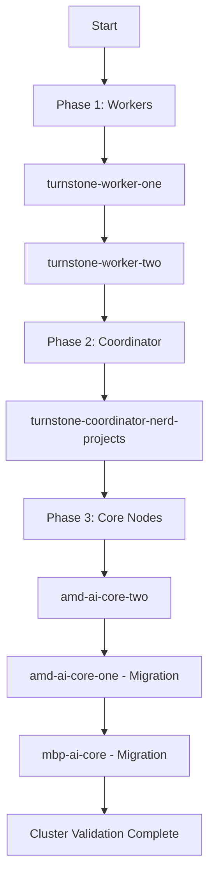

# Technical Implementation Plan: NVIDIA PAIR Upgrade to v1.0.0

## 1. Overview
This document outlines the procedure for upgrading the NVIDIA Personal AI Router (PAIR) installation to version 1.0.0 across the cluster. The primary objective is to transition from legacy engine configurations (specifically LM Studio on core nodes) to the new `llama.cpp` engine manager while maintaining maximum cluster availability.

### Scope
- **Target Version:** 1.0.0
- **Affected Nodes:** 
  - `mbp-ai-core` (Core/LM Studio $\rightarrow$ llama.cpp)
  - `amd-ai-core-one` (Core/LM Studio $\rightarrow$ llama.cpp)
  - `amd-ai-core-two` (Standard Upgrade)
  - `turnstone-worker-one` (Standard Upgrade)
  - `turnstone-worker-two` (Standard Upgrade)
  - `turnstone-coordinator-nerd-projects` (Standard Upgrade)

---

## 2. Constraints & Strategy

### Key Technical Constraints
- **No Side-by-Side Support:** PAIR uses a global config directory (`~/.config/Nvidia Corporation/Personal AI Router/`) and fixed ports. Parallel versions cannot coexist on the same node.
- **Engine Incompatibility:** Models used by LM Studio are not compatible with the `llama.cpp` engine manager; GGUF formats must be explicitly provisioned in `~/.llamacpp`.

### Upgrade Strategy: Rolling Deployment
To minimize disruption, a rolling upgrade will be performed. We will prioritize "edge" nodes (workers) before moving to core infrastructure. This allows for early detection of regression in the 1.0.0 binaries before impacting primary inference paths.



---

## 3. Detailed Execution Procedure

### 3.1 Standard Node Upgrade (Workers/Coordinator)
For nodes not requiring engine migration:
1. **Backup Configuration:**
   `cp -r "~/.config/Nvidia Corporation/Personal AI Router/" ~/.pair_backup_pre_1_0_0`
2. **Binary Replacement:**
   - Stop existing PAIR process.
   - Replace legacy binaries with v1.0.0 portable binaries.
3. **Configuration Migration:**
   - Run the v1.0.0 migration script (if provided) or manually update config to align with new schema.
4. **Service Restart:**
   - Launch PAIR 1.0.0 and verify process stability.

### 3.2 Core Node Engine Migration (`mbp-ai-core`, `amd-ai-core-one`)
These nodes require a transition from LM Studio to the `llama-server` API managed by PAIR 1.0.0.

**Migration Workflow:**
1. **Model Audit:**
   - List all active models currently served via LM Studio on the node.
   - Record specific model versions and quantization levels (e.g., Q4_K_M).
2. **Provisioning GGUF Cache:**
   - Initialize `~/.llamacpp` directory.
   - Pull corresponding GGUF versions from Hugging Face using the PAIR 1.0.0 pull utility or manual `wget/curl`.
3. **Parallel Validation (Temporary Port Shift):**
   - Since ports collide, temporarily shift LM Studio to a non-standard port if possible, OR perform a hard cutover during a maintenance window.
   - Configure PAIR 1.0.0 Engine Manager to point to `llama-server`.
4. **Verification Loop:**
   - Execute test queries against the new `llama.cpp` backend:
     ```bash
     curl -X POST http://localhost:8080/v1/chat/completions ...
     ```
   - Verify that automatic eviction (300s inactivity) is functioning as expected to manage VRAM.
5. **Deprecation:**
   - Once verified, permanently disable the LM Studio service and reclaim system resources.

---

## 4. Rollback Plan

In the event of a critical failure (e.g., segmentation faults on specific hardware or API regressions):

1. **Process Termination:** Kill all v1.0.0 PAIR processes.
2. **Config Restoration:**
   `rm -rf "~/.config/Nvidia Corporation/Personal AI Router/"`
   `cp -r ~/.pair_backup_pre_1_0_0 "~/.config/Nvidia Corporation/Personal AI Router/"`
3. **Binary Reversion:** Restore previous binary versions from the `/workspace/nvidia-pair-teqonix/backups` directory.
4. **Engine Recovery:** For core nodes, restart the LM Studio service to restore inference capabilities immediately.

---

## 5. Post-Upgrade Validation Checklist

Each node must pass the following checks before being marked as "Healthy":

| Check | Method | Expected Result |
| :--- | :--- | :--- |
| **Process Status** | `ps aux \| grep pair` | Process running without restart loops |
| **API Reachability** | `curl localhost:8080/health` | HTTP 200 OK |
| **Model Loading** | TUI / API Load Call | Model loads into VRAM successfully |
| **Inference Test** | Prompt "Hello" $\rightarrow$ Response | Coherent text output returned < 2s (TTFT) |
| **Engine Eviction** | Wait 305s $\rightarrow$ Check VRAM | VRAM released after inactivity |
| **Config Integrity** | `cat ~/.config/.../config.json` | No JSON syntax errors or missing keys |

---

## 6. Schedule & Coordination
- **Maintenance Window:** [Insert Date/Time]
- **Primary Engineer:** teqonix
- **Communication Channel:** Project Coordinator / Discord
