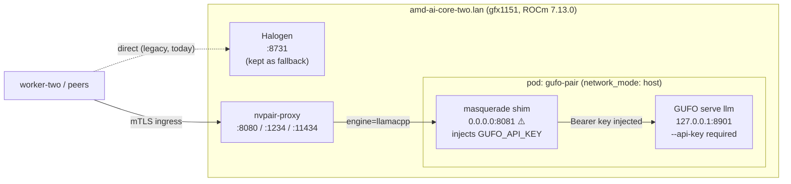

# GUFO → PAIR deployment runbook — `amd-ai-core-two.lan`

Operator-executable sequence. Supersedes `PLAN.md` §13 (Recommended execution order).
`PLAN.md` remains the design doc; **this file is what you run.**

Validated against live state on 2026-10-30.

---

## 0. Read this before touching anything

Three findings from live inspection change the plan you drafted. Each is load-bearing.

### 0.1 `nvpair.service` is NOT just a TUI — stopping it removes the whole node ⚠️

The unit is named *"PAIR TUI tmux session"*, which makes it sound cosmetic. It is not.
Every PAIR daemon is parented **inside** the tmux session the unit owns:

```
nvpair.service  (Type=forking, Restart=always, RestartSec=5s)
└─ tmux new-session -d -s pair nvpair-tui          [1305]
   └─ nvpair-tui                                    [1306]
      └─ nvpair-ui-broker                            [1340]
         ├─ nvpair-node-scanner                     [1361]
         ├─ nvpair-errors --peer-sync               [1363]
         ├─ nvpair-node-settings                    [1370]
         ├─ nvpair-engine-manager  :14322/:14323    [1392]   ← loads engine manifests
         ├─ nvpair-node-info        :14318           [1416]
         ├─ nvpair-proxy  :8080 :1234 :11434        [1417]   ← the façade
         ├─ nvpair-workload-manager :14320           [1433]
         ├─ nvpair-manual-nodes                      [1438]
         ├─ nvpair-cluster-manager  :14321           [1444]
         └─ nvpair-job-scheduler                    [1445]
```

There is no separate `nvpair-proxy.service`. `systemctl stop nvpair` tears down **all 11
daemons and the façade with it** — the node leaves the cluster entirely.

> [!IMPORTANT]
> Your step 1 ("disable the existing PAIR service") is therefore a **full cluster-node
> outage on core-two**, not a cosmetic TUI stop. That is acceptable for this migration,
> but it must be understood as such: peer nodes will see core-two disappear until step 9.
>
> It also means the shim cannot be smoke-tested "through PAIR" while PAIR is stopped.
> Step 4 below tests the shim **directly**; PAIR-mediated checks move to step 9.

### 0.2 This conversation does NOT go through PAIR — it hits Halogen directly ✅

Your concern *"if the plan requires running a PAIR façade, I am concerned about this
solution working"* is resolved by the routing evidence. The inference path for this
session bypasses PAIR completely:

```
turnstone-worker-two (192.168.60.166)  ──HTTP──►  core-two:8731  (Halogen)
```

Confirmed in the Halogen journal during this session:

```
INFO:  192.168.60.166:53882 - "POST /v1/chat/completions HTTP/1.1" 200 OK
serve_api: mtp 1865 tok in 47.77s = 39.04 t/s | prompt 50904, prefill 37.96s
```

| Question | Answer |
|---|---|
| Does stopping PAIR kill this session? | **No.** Nothing on the path depends on PAIR. |
| Does stopping Halogen kill this session? | **Yes.** It is the direct inference backend. |
| Does PAIR masquerade as the inference path? | No — PAIR is a *router/registry* layer here, not this session's transport. |

**Consequence:** the GUFO migration is safe to perform with respect to this session,
right up until Halogen is stopped. Gate everything on that one event.

### 0.3 Your step 7/8 ordering is inverted and unsafe 🔴

You listed: `7. Disable Halogen` → `8. Smoke test GUFO`.

If GUFO is not already verified serving when Halogen dies, there is **no model left on
the network**. This session dies mid-sentence and the cluster is down with no tested
fallback. The correct order is **prove GUFO first, then cut over**, with automatic
restoration of Halogen if the post-cutover probe fails.

`ops/cutover_halogen.sh` enforces exactly that ordering and auto-restores. Never stop
Halogen by hand.

---

## 1. Target state



### Port map, verified live

| Port | Status today | Owner after deploy | Note |
|---|---|---|---|
| `8080` | BUSY — `nvpair-proxy` | PAIR façade (unchanged) | Do not bind. Plaintext from remote peers is refused: `{"code":"loopback-only"}`; peers must use mTLS ingress. |
| `8081` | **FREE** | **shim** (PAIR probes this) | = manifest `runtime.port` |
| `8901` | **FREE** | **GUFO** (loopback only) | GUFO defaults to 8080 → **must** pass `--port 8901` |
| `8731` | BUSY — Halogen, up 8 days | Halogen (fallback until final decommission) | `Restart=always`; stop via script only |

> [!WARNING]
> **Security defect in `container/compose.yaml`.** The shim is configured
> `SHIM_HOST: "0.0.0.0"` while `manifest/llamacpp.json` declares `bind: "127.0.0.1"`.
> PAIR authenticates to the shim with **no credentials** (the shim holds the GUFO key and
> injects it). Binding `0.0.0.0` therefore exposes an **unauthenticated inference proxy
> with a valid GUFO API key** to the entire LAN.
> Set `SHIM_HOST: "127.0.0.1"` before deploying — see step 2.

---

## 2. Prerequisite gap: GUFO is not installed and must be built 🔴

This is the largest unaccounted-for item in the original plan.

| Check | Result |
|---|---|
| `which gufo` | **not found** — no binary, no image |
| `localhost/gufo:latest` (compose default) | **absent** |
| Build deps present | `cmake 3.31`, `ninja 1.12`, `pkg-config`, `build-essential`, `libcurl`, `libssl` |
| Build deps **MISSING** (12) | `hipblas-dev` `hipblaslt-dev` `rocblas-dev` `hipcub-dev` `rocprim-dev` `rocwmma-dev` `libicu-dev` `libpng-dev` `libjpeg-dev` `libwebp-dev` |
| Compiler on host | **GCC 14.2.0** |
| Qualified toolchain | **GCC 15.3 + ROCm 7.2.3** |
| Host ROCm | **7.13.0** (Debian `therock-gfx1151`, not upstream ROCm 6.x/7.2.x) |
| `ENGINE_ENABLE_HIP` | `ON` by default (`CMakeLists.txt:47`) — gfx1151 HIP backend |

Two independent risks:

1. **Toolchain drift.** GUFO is qualified against GCC 15.3 / ROCm 7.2.3. The host has
   GCC 14.2 / TheRock 7.13.0. Compilation may fail outright, or produce a binary with
   unvalidated kernel behaviour on the 8060S.
2. **ROCr queue-memory patch — verified to be a ROCm-runtime patch, not a GUFO patch.**
   `git apply --check .devops/nix/patches/rocr-fixed-cwsr.patch` against the GUFO tree
   fails outright: the patch targets `libhsakmt/src/queues.c` and
   `runtime/hsa-runtime/core/runtime/amd_memory_region.cpp` / `amd_loader_context.cpp` —
   **AMD's ROCr runtime**, not GUFO sources. GUFO's Nix package injects it via
   `rocmPackages.rocm-runtime.overrideAttrs`.

   Consequence: a non-Nix build **cannot** include this protection without rebuilding
   ROCm from source. The patch forces non-paged GTT for queue save/restore areas on
   gfx1151 (`EngineId` 11.5.1) so host memory compaction cannot evict GPU queues.
   core-two runs 125 GiB unified memory already at ~43% VRAM / ~38 GiB used while
   Halogen serves 50 k-token contexts — precisely the compaction-prone regime the patch
   exists for. Running Flash-Next without it risks queue-eviction stalls.

**Recommended build route: the Nix flake, inside a container** (`build_gufo.sh --route nix`).
It gives the qualified GCC 15.3 + ROCm 7.2.3 closure *and* the patched ROCr automatically,
while leaving the host's TheRock userspace untouched. The CMake route (`--route plain`) is
available but ships **without** queue-eviction protection unless the base image already
carries a patched ROCr 7.2.3 — verify before trusting it on this host.

> [!WARNING]
> Do **not** build GUFO on the bare host. Two reasons: (a) the host lacks all six ROCm
> `-dev` packages and installing a competing ROCm/hipBLAS stack under a live inference
> engine is a bad idea; (b) a GCC 14.2 build against TheRock headers is a multi-hour
> gamble that also silently omits the ROCr queue-memory fix.

### Model weights: Halogen's `.hgn` files are not reusable

GUFO's LLM path takes a **GGUF** (`gufo serve llm --model PATH`, `serve.cpp:1174`).
Halogen's weights are `.hgn` (its own format) and cannot be consumed:

| Halogen weights (`/home/turnstone/halogen-models/`) | Reusable with GUFO? |
|---|---|
| `qwen38-flash-next-w4b.hgn` (124 GB) | ❌ wrong format |
| `qwen38-flash-next-mtp.hgn`, `-vision.hgn`, `.overlay.hgn` | ❌ wrong format |

**GUFO qualifies exactly one target** (`docs/models/qwen3.8-flash-next/README.md`):

```
unsloth/Qwen3.8-Flash-Next-GGUF
  @ 38bb39ee97821de2c9009abb7e93950eec396e66
    UD-Q4_K_XL/*                                 111.33 GB   the qualified target
    MTP/mtp-Qwen3.8-Flash-Next-shared-Q8_0.gguf  (optional)  speculative decode
    mmproj-BF16.gguf                             (optional)  vision projector
```

The repo states outright: *"Original unquantized-model and GGUF-conversion parity
remain unqualified."* Any other quant leaves the qualified configuration. Use
`ops/provision_model.sh` to pull exactly this pinned set.

GGUF candidates already on the host — **none of which are the qualified quant**:

```
/home/turnstone/models/Qwen3.8-Flash-Next-GGUF/UD-IQ4_XS/   ~93 GB  unqualified quant
/home/turnstone/.models/Qwen3.8-Flash-Next-IQ4_NL-PROJFIX-0000{1..9}-of-00009.gguf  96 GB  custom, unqualified
/home/turnstone/models/Ministral-3-14B-Instruct-2512-GGUF/Ministral-3-14B-Instruct-2512-UD-Q4_K_XL.gguf  8.4 GB
/home/turnstone/models/Qwen-3.8-27B-ROCmFP4-FAST-GGUF/Qwen3.8-27B-ROCmFP4-FAST.gguf  15 GB
/home/turnstone/models/gemma-4-31B-it-GGUF/gemma-4-31B-it-UD-Q4_K_XL.gguf  18 GB
```

`compose.yaml` mounts `${GUFO_MODELS_DIR}:/models:ro`. `deploy_stack.sh` now
defaults `GUFO_MODELS_DIR` to the qualified `UD-Q4_K_XL` path (to be provisioned)
rather than the repaired-IQ4 set.

> [!NOTE]
> The 8.4 GB **Ministral-3-14B** is the right choice for the *binary/plumbing*
> smoke test even though it is the wrong model: it proves the GUFO binary runs on
> this GPU under ROCm 7.2.3 and that the shim contract holds, using a quarter of
> the memory. See §2.1 before starting anything with the 111 GB set.

---

## 2.1 Can both models be loaded at once? (the OOM question)

**Short answer: not the full pair. The 111 GB GUFO set cannot safely coexist with
Halogen's ~85 GB of mapped weights on this box.**

Measured on `amd-ai-core-two` (not estimated):

```
MemTotal        131,167,720 kB  = 125.0 GiB
MemAvailable     90,421,012 kB  =  86.2 GiB
SwapTotal                 0 kB  =   0 GiB      <-- the decisive number
Mapped           85,234,292 kB  =  81.2 GiB
Unevictable           6,004 kB  =   5.7 MiB
```

### What the numbers actually mean

The 81 GiB "Mapped" is **file-backed page cache**, not pinned memory. The proof is
`Unevictable: 5.7 MiB` — if Halogen's weights were `mlock`ed, that figure would be
~85 GB. So the kernel *can* reclaim those pages, and does not count them against
`MemAvailable` as though they were lost.

That alone would make this look safe. It is not, because of what GUFO allocates on
top:

| Memory class | Backing | Reclaimable with Swap=0? |
|---|---|---|
| GGUF weights read through page cache | file | ✅ yes — dropped under pressure |
| KV cache / session state | **anonymous** | ❌ **no** |
| Activations, scratch buffers | **anonymous** | ❌ **no** |
| Registered HIP host buffers (`PinHostPages`) | anon, pinned | ❌ **no** |

`src/core/hip/host_allocations.hpp` shows GUFO deliberately pins host pages via
io_uring registration to stop CPU compaction from moving GPU registrations. Those
bytes cannot be reclaimed at all.

**With `Swap: 0` there is no safety valve.** Anonymous memory cannot be paged out,
so when the working set exceeds physical RAM the kernel goes straight to the OOM
killer — and the largest, easiest target is Halogen's 85 GB mapping. The failure
mode is not "GUFO is slow"; it is **the OOM killer executing your rollback path.**

### What GUFO's own benchmark says

`docs/models/qwen3.8-flash-next/BENCHMARKS.md` §Memory occupation, C1 AR on a
128 GB Strix Halo:

| Workload | GUFO peak | llama.cpp peak |
|---|---:|---:|
| pp2048 + tg128 | **88.78 GiB** | 84.84 GiB |
| 16K prefix, pp4096 + tg128 | **90.53 GiB** | 85.31 GiB |

Note the peak (88.78 GiB) is measured at **context capacity 133121 on an idle
host**. It is *less* than the 111 GB of weights, which confirms GUFO streams
weights through evictable cache rather than keeping all of them resident. But
88.78 GiB of peak on a machine with 86 GiB available and a live 85 GB Halogen
mapping is over budget by any margin.

Also note: `--context 0` means **native context from model metadata = 262,144
tokens per session** for this model — *not* the 133121 that was benchmarked.
GUFO admits by reserving the full configured capacity up front, so leaving it at
`0` is the worst possible setting here. `compose.yaml` now pins
`--context ${GUFO_CONTEXT:-32768}`.

### The two safe paths

**A — Smoke test with a small model (Halogen untouched).** Prove the binary, the
ROCm 7.2.3 closure and the shim contract using the 8.4 GB Ministral. This is the
recommended first move; the model identity is wrong but every plumbing failure mode
is identical.

```bash
GUFO_MODELS_DIR=/home/turnstone/models/Ministral-3-14B-Instruct-2512-GGUF \
GUFO_MODEL_FILE=Ministral-3-14B-Instruct-2512-UD-Q4_K_XL.gguf \
GUFO_CONTEXT=4096 GUFO_MIN_AVAIL_GIB=20 \
  ops/deploy_stack.sh --host amd-ai-core-two.lan --start
```

**B — Full qualified model: cut over first, then load.** Halogen's 85 GB is
reclaimable the moment Halogen stops. Freeing it is what makes the 111 GB set fit.
Run `cutover_halogen.sh` from a session **not** served by `core-two:8731`, then
start GUFO. This inverts the usual ordering deliberately — with `Swap: 0` you
cannot afford a moment where both are resident.

`deploy_stack.sh` step **5b** enforces this and refuses to start when
`SwapTotal == 0` and `MemAvailable` is below the tier for the chosen context:

| `GUFO_CONTEXT` | required `MemAvailable` |
|---|---|
| ≤ 8192 | 24 GiB |
| ≤ 32768 | 50 GiB |
| > 32768 | 95 GiB |

Verified against the live host right now (86 GiB available):

```
ctx=4096     need=24  -> pass
ctx=32768    need=50  -> pass
ctx=133121   need=95  -> REFUSE
ctx=262144   need=95  -> REFUSE
```

The tiers are **estimates derived from one qualified data point**, not measured
curves. `GUFO_ALLOW_COEXIST=1` overrides the guard; do not use it to get past a
refusal at full context — that is precisely how the fallback dies.

---

## 3. Corrected execution sequence

Steps 1–6 are **non-destructive**: Halogen keeps serving, this session stays alive.
Step 7 is the only point of no return.

> [!IMPORTANT]
> **Steps 1–6 are safe for an agent to execute. Step 7 will kill any session whose
> inference runs on core-two:8731 — including this one.** `cutover_halogen.sh`
> requires an explicit `--i-am-not-running-on-halogen` flag for exactly this reason.

| # | Step | Script | Kills this session? |
|---|---|---|---|
| 1 | Preflight gate (re-verify all assumptions) | `ops/preflight.sh` | No |
| 1b | Provision qualified weights (~114 GB, resumable) | `ops/provision_model.sh --run` | No |
| 2 | Stage artifacts + fix shim bind + env | `ops/deploy_stack.sh --stage-only` | No |
| 3 | Build GUFO image (off-host toolchain) | `ops/build_gufo.sh --route nix` | No |
| 4 | Start GUFO + shim **alongside** Halogen — **small model only** | `ops/deploy_stack.sh --start` | No |
| 5 | Smoke-test shim **directly** (PAIR still down) | `ops/smoke_pair_facade.sh --direct` | No |
| 6 | Start PAIR, verify adoption + peer visibility | `ops/smoke_pair_facade.sh --via-pair` | No |
| 7 | **Cutover**: stop+mask Halogen, auto-restore on failure | `ops/cutover_halogen.sh` | ⚠️ **YES — only after GUFO proven** |
| 8 | Swap in the full qualified weights, re-smoke | `deploy_stack.sh --start` + `--post-cutover` | No (Halogen already down) |
| 9 | Persist: systemd user unit + linger | `ops/commit_deployment.sh` | No |

> [!IMPORTANT]
> **Step 4 only works alongside Halogen with a small model.** The full 111 GB
> `UD-Q4_K_XL` set cannot be loaded while Halogen holds its ~85 GB mapping
> (`SwapTotal=0` — see §2.1). The guard in `deploy_stack.sh` 5b enforces this.
>
> This creates a deliberate split in the "prove before cutover" rule:
>
> - **Step 4/5 prove the binary, the ROCm 7.2.3 closure, the CWSR patch and the
>   shim contract** using the 8.4 GB Ministral. Everything that can fail at the
>   plumbing level fails here, with Halogen intact as the fallback.
> - **Step 8 proves the actual qualified weights.** It necessarily runs after
>   cutover, because memory physically forbids both being resident. If the full
>   weights fail at step 8, `rollback_all.sh` restores Halogen — the fallback
>   survives, just not the PAIR-serving window.
>
> Do not "fix" this by setting `GUFO_ALLOW_COEXIST=1` at step 4. That converts a
> recoverable failure into the OOM killer choosing which process dies.
| 8 | Post-cutover end-to-end test | `ops/smoke_pair_facade.sh --post-cutover` | No (Halogen already down) |
| 9 | Commit: keep Halogen masked, persist GUFO at boot | `ops/commit_deployment.sh` | No |
| — | Roll back everything | `ops/rollback_all.sh` | Restores session |

### Why this differs from your draft

| Your step | Issue | Correction |
|---|---|---|
| 1. Disable PAIR | Not needed first; stopping it is a full node outage and blocks any PAIR-mediated test | Deferred to step 6, where it's immediately reversed |
| 2. Install shim into PAIR facade | Manifest override is additive — no need to stop PAIR to write it | Step 2, PAIR untouched |
| 3. Smoke test "other nodes can see it" | Impossible with PAIR stopped | Step 6, after PAIR restart |
| 5. Install GUFO | GUFO isn't installable — needs a source build with 12 missing deps | Step 3, isolated in a container |
| 7. Disable Halogen → 8. Test GUFO | Unproven model + dead fallback = unrecoverable | **Swapped**: prove GUFO first (5), then cut over (7) with auto-restore |

---

## 4. Step-by-step commands

All commands run from **`turnstone-worker-two`** unless marked `(core-two)`.
`HOST=amd-ai-core-two.lan` for brevity.

```bash
HOST=amd-ai-core-two.lan
RB=/workspace/nvidia-pair-teqonix/gufo_pair_adoption
```

### Step 1 — Preflight gate

```bash
bash $RB/ops/preflight.sh --host $HOST
```

Exits non-zero on any blocker. Re-checks: ROCm/gfx1151, port map, podman rootless +
GPU passthrough, disk/RAM headroom, PAIR unit topology, Halogen state, GUFO build deps,
model files, the `0.0.0.0` shim-bind defect, and **whether the calling session is itself
routed through core-two:8731**.

### Step 2 — Stage artifacts (non-destructive)

```bash
bash $RB/ops/deploy_stack.sh --host $HOST --stage-only
# then, on core-two, fix the shim bind before any start:
ssh $HOST 'sudo sed -i "s/SHIM_HOST: \"0.0.0.0\"/SHIM_HOST: \"127.0.0.1\"/" /opt/gufo-pair/compose.yaml'
ssh $HOST 'grep -n SHIM_HOST /opt/gufo-pair/compose.yaml'
```

Creates `/opt/gufo-pair`, `/var/lib/gufo-masquerade`, model dir; writes
`/etc/gufo-pair/env` mode `0600` from `ops/env.sample` with a **freshly generated**
`GUFO_API_KEY` (never committed). Installs the manifest override with timestamped backup.

### Step 3 — Build GUFO (Nix route — required for the ROCr queue fix)

```bash
# Prints the build command; run it detached (long compile):
bash $RB/ops/build_gufo.sh --host $HOST --route nix
ssh $HOST 'cd ~/gufo-build-src && nohup podman build -f Containerfile.build -t localhost/gufo:latest . > ~/gufo-build.log 2>&1 &'
ssh $HOST 'tail -f ~/gufo-build.log'

# After it finishes, verify without rebuilding:
bash $RB/ops/build_gufo.sh --host $HOST --verify-only
```

Default `--route nix` builds GUFO's own flake inside `nixos/nix`: qualified
GCC 15.3 + ROCm 7.2.3 **and** the `rocr-fixed-cwsr` ROCr patch, with the host's
TheRock userspace untouched. The runtime stage copies `/nix` so the makeWrapper'd
`gufo` script resolves its store deps.

`--route plain` (CMake against a base image) exists but ships **without** the
queue-eviction fix — use only if the base already carries a patched ROCr 7.2.3.

Either route verifies `gufo diagnose` reports gfx1151/HIP and refuses to claim
success otherwise. Expect a long compile (nix route also fetches the ROCm closure;
core-two has 45 GB reclaimable image storage).

### Step 4 — Start GUFO + shim alongside Halogen

```bash
ssh $HOST 'sudo -u turnstone /usr/local/bin/gufo-pairctl start'
ssh $HOST 'sudo -u turnstone /usr/local/bin/gufo-pairctl status'
```

Ports differ, so GUFO and Halogen coexist. Both compete for unified memory — see the
`memlock` / VRAM note in §5 before doing this while Halogen holds a 50 k-token context.

### Step 5 — Smoke-test shim directly (PAIR still stopped)

```bash
bash $RB/ops/smoke_pair_facade.sh --host $HOST --direct
```

Validates the shim's own contract without PAIR: `/props` → `role=router`, `/health`,
`/models`, `/v1/models`, and an actual completion through the shim → GUFO → back.
This is the **gate for step 7**.

### Step 6 — Start PAIR, verify adoption + peer visibility

```bash
ssh $HOST 'sudo systemctl start nvpair'
bash $RB/ops/smoke_pair_facade.sh --host $HOST --via-pair
```

Checks: engine-manager adopted `llamacpp.json` as GUFO, **no `llama-server` binary was
downloaded** (the neutralisation invariant), façade routes to the shim, and a peer node
resolves core-two through the mTLS ingress.

### Step 7 — Cutover ⚠️

> [!DANGER]
> **This stops the inference backend serving this conversation.** After the point of
> no return, if GUFO cannot serve, this session is dead.
>
> Execute from a session **not** backed by core-two:8731 — a different node, a
> different model, or a plain terminal. The script enforces this with a required flag.

```bash
# REQUIRED: explicit acknowledgement that the caller is not on the Halogen inference path
CONFIRM_STOP_HALOGEN=yes \
  bash $RB/ops/cutover_halogen.sh --host $HOST --i-am-not-running-on-halogen
```

The script, in order:

1. **Re-proves** GUFO serves a real completion (never trusts cached state).
2. Snapshots Halogen's exact unit state + env for rollback.
3. `systemctl stop halogen-flash-server && systemctl mask halogen-flash-server`
   — masking prevents `Restart=always` / a stray reboot resurrecting it mid-migration.
4. Runs the post-cutover probe against GUFO via the PAIR façade.
5. **On any failure: automatically unmasks and restarts Halogen**, then reports.

### Step 8 — Post-cutover end-to-end test

```bash
bash $RB/ops/smoke_pair_facade.sh --host $HOST --post-cutover
```

### Step 9 — Commit

```bash
bash $RB/ops/commit_deployment.sh --host $HOST
```

Ensures `nvpair` enabled at boot, records the GUFO deployment marker, prints the
decommission path for Halogen (taken as a separate, deliberate decision).

### Roll back at any time

```bash
bash $RB/ops/rollback_all.sh --host $HOST              # restores Halogen, reverts override, PAIR as before
bash $RB/ops/rollback_all.sh --host $HOST --halogen-only  # just bring Halogen back
```

---

## 5. Known risks & open questions

| # | Risk | Severity | Mitigation |
|---|---|---|---|
| 1 | Toolchain mismatch: GUFO qualified on GCC 15.3 / ROCm 7.2.3; host is GCC 14.2 / TheRock 7.13.0 | **High** | Build in pinned container (`build_gufo.sh`); do not build on host toolchain |
| 2 | Missing ROCr `fixed-cwsr` queue-memory patch → queue-eviction faults under unified-memory pressure | **High** | **Verified:** the patch targets ROCr (`libhsakmt`, `hsa-runtime`), **not** GUFO — `git apply --check` against the GUFO tree fails. It therefore **cannot** be bolted onto a non-Nix build. Use `--route nix`, which applies it via `rocmPackages.rocm-runtime.overrideAttrs` |
| 3 | Shim bound `0.0.0.0` = unauthenticated LAN proxy holding a live GUFO key | **High** | Force `127.0.0.1` in step 2; `preflight.sh` fails if not fixed |
| 4 | Halogen `.hgn` weights unusable → GUFO serves a *different* model than this session expects | Medium | **RESOLVED:** provision GUFO's qualified `UD-Q4_K_XL` set via `ops/provision_model.sh` (§2). The IQ4 sets on the host are explicitly unqualified per GUFO's docs |
| 5 | **OOM with `SwapTotal=0`:** GUFO's anon working set (KV/activations/pinned HIP buffers) cannot be paged out; OOM killer takes Halogen — **the rollback path** | **High** | Full 111 GB set cannot coexist with Halogen's 85 GB mapping (§2.1). Guard in `deploy_stack.sh` 5b refuses when `Swap=0` and `MemAvailable` < tier. Smoke-test on 8.4 GB Ministral, or cut Halogen over *before* loading full context. `GUFO_ALLOW_COEXIST=1` overrides — don't |
| 6 | `Restart=always` on both units → half-dead states after manual intervention | Medium | Scripts `mask` rather than merely `stop`; always use the scripts |
| 7 | PAIR node outage during steps 6–9 (11 daemons restart) | Low–Med | Window is minutes; peers fail over or queue |

### Needs your decision before step 4

1. **Which GGUF should GUFO serve?** — **RESOLVED:** GUFO's qualified target,
   `unsloth/Qwen3.8-Flash-Next-GGUF @ 38bb39ee` / `UD-Q4_K_XL` (111.33 GB),
   pulled with `ops/provision_model.sh`. Prior default (IQ4_NL-PROJFIX) dropped —
   unqualified per GUFO's own docs.
2. **Is a PAIR node outage on core-two acceptable right now?** (Peers lose core-two for
   the step 6–9 window.)
3. **Build route — now strongly biased to Nix.** The CWSR fix is a *ROCm runtime*
   patch, so `--route plain` ships without it. Options:
   - **`--route nix` (recommended):** qualified GCC 15.3 + ROCm 7.2.3 closure **and**
     the patched ROCr, built inside `nixos/nix` on core-two. No host changes.
     Cost: large download + long compile; core-two has 582 GB free and ~45 GB
     reclaimable image storage.
   - **`--route plain`:** faster only if you already have a base image carrying a
     **patched** ROCr 7.2.3. Otherwise it knowingly omits the fix — risky on
     125 GiB unified memory at 43% VRAM with compaction pressure.
   - Note: Nix is **not installed** on core-two; the container route avoids needing it
     on the host.
4. **Halogen decommission** is explicitly **out of scope** here — confirm it stays
   masked-but-installed rather than removed. The GUFO path changes the model anyway
   (GGUF ≠ `.hgn`), so Halogen is the only way to run the exact current weights.
