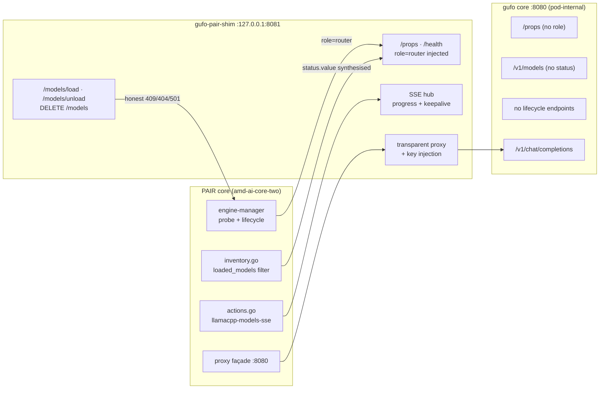
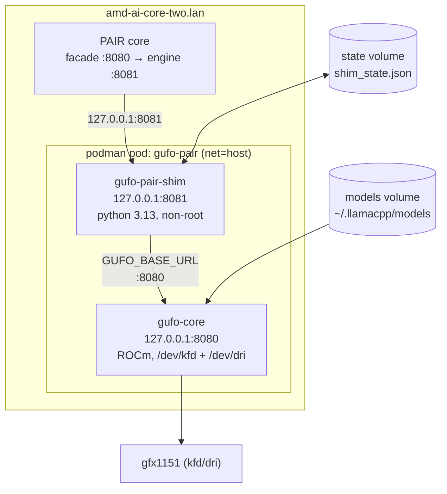
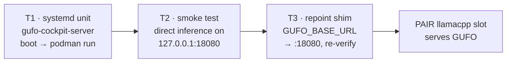

# GUFO ⇄ PAIR masquerade — technical plan

**Branch:** `gufo-pair-masquerade-impl`
**Target node:** `amd-ai-core-two.lan` (Strix Halo, gfx1151)
**Goal:** PAIR drives GUFO through its `llamacpp` (llama.cpp-router) engine slot.
GUFO stays the real inference engine; a thin shim closes the control-plane gaps.
**Rollback target:** Halogen Qwen 3.8 Flash Next (`halogen-flash-server-teqonix`).
**Revision 2 (2026-11-01, bookmark `gufo-shim-update`):** GUFO is now consumed as
the **vendor-qualified prebuilt image**
`docker.io/kyuz0/amd-strix-halo-toolboxes:rocm-10.0-gufo` and is brought up by a
**systemd unit on `amd-ai-core-two.lan`**, not by a hand-built container. All
tasks about building GUFO from source are **removed** (see §11 resolution note).
The open work is now three tasks: **T1** systemd service, **T2** smoke test,
**T3** retarget the shim (§13).

> [!IMPORTANT]
> This is a **plan + staged artefacts only** deliverable. Nothing here has been
> installed on `amd-ai-core-two.lan`. `/workspace` on the staging node is a
> read-only NFS export, so everything lives in
> `/var/lib/turnstone/gufo_pair_adoption/` and is placed by `lander.sh`
> (§12) on a node with a writable `/workspace`.

---

## 1. Why a shim is needed at all

PAIR's `llamacpp` engine is not "OpenAI-compatible" — it is a **router-shaped**
contract: `llama-server --router` / `llama.cpp-router`. It parses specific
objects, not just status codes. We reproduced every client-side decoder from
`services/nvpair-engine-manager/{lifecycle.go,status.go,inventory.go,actions.go}`
and enumerated the divergences against GUFO v0.20.0.



### The eight gaps (all now covered by contract tests)

| ID | PAIR expects | GUFO v0.20.0 provides | Shim closure |
|----|--------------|----------------------|--------------|
| **G1** | `GET /props` → `role: "router"` (identity probe, `PAIR_PROBE_HEADER`) | `/props` has model fields but **no `role`** | Inject `role: "router"`, preserve all GUFO fields |
| **G2** | `POST /models/load {model}` | endpoint absent | 200 if resident; `404` unknown; `400` missing field |
| **G3** | `POST /models/unload` | absent | Live model → honest `409`; `force:true` → ack; in-flight download → cancel |
| **G4** | `DELETE /models?model=` | absent | Removes inventory row; refuses live by default; `404` unknown; `400` no param |
| **G5** | `llamacpp-models-sse` progress frames, 0–100, multi-file aggregate, keepalive | nothing | Synthesised hub; foreign-model frames dropped by PAIR matcher |
| **G6** | `loaded_models` filter reads `data[].status.value ∈ {loaded}` | rows carry **no `status`** → PAIR sees *nothing* | Synthesise `status.value` + `status.normalized` on every row |
| **G7** | unsupported task types fail fast | n/a | Explicit `501` rather than silent success |
| **G8** | pull of an already-resident model still completes the SSE handshake | n/a | `complete` frame, no hang |

> [!WARNING]
> **G6 is the one that silently breaks everything.** PAIR's `loaded_models`
> action filters on `status.value`. Raw GUFO rows have no `status`, so PAIR's
> inventory renders **empty** — not an error, just an empty list, which looks
> like "engine has no models". The test `G6 raw GUFO would be invisible to PAIR
> filter` exists specifically to keep that from regressing.

### Non-negotiable shim properties (tested)

* **Holds the GUFO API key internally.** PAIR never sends credentials; the shim
  injects `Authorization: Bearer …` on every upstream call.
* **Strips PAIR's identity-probe header** before forwarding, so GUFO never sees
  router-detection traffic.
* **Honest on unlisted paths** — proxies them; never fabricates `200`.
* **Honest when GUFO is dead** — `/health` fails (`502`/`503`), so PAIR's health
  probe marks the engine down. `DEAD upstream never reports ready` guards this.
  The control surface stays alive so PAIR can still talk to us, but readiness is
  never a lie.
* **Never invents successful lifecycle transitions** it cannot honour.

---

## 2. Topology



> [!NOTE]
> **Revision 2 supersedes the pod topology for GUFO.** GUFO no longer runs inside
> a `net=host` pod next to the shim. It runs as a **standalone rootless container**
> (`gufo-cockpit-server`) on podman's default network, with its port published to
> **host loopback only** via `-p 127.0.0.1:18080:18080`. The shim still binds
> `127.0.0.1:8081` and reaches GUFO at `http://127.0.0.1:18080`. Everything in
> this section describing GUFO at `:8080` inside the pod is retained only as the
> historical rationale for the shim's bind address; the port map of record is §14.

**Why `net=host`.** PAIR's readiness/health probes are hard-coded against
`127.0.0.1:{port}` (`runtime.ready.http`, `runtime.health.http`). With a
host-network pod, the shim's `127.0.0.1:8081` bind *is* the address PAIR
probes, GUFO reaches the shim over loopback, and `ss -tlnp 'src *:8081'`
identifies the process the way `reconcilePresence` expects. A bridge-network pod
would require PAIR to probe a pod IP it does not know about.

**Port budget.** PAIR's façade occupies `8080` at the *host* level for client
traffic; GUFO's `8080` must therefore **not** be published to the host. Only
`8081` is bound, and only to loopback. Verify with:

```bash
ss -tlnp | grep -E ':(8080|8081)\s'
# expect: 127.0.0.1:8081 shim   |   127.0.0.1:8080 gufo (not 0.0.0.0:8080)
```

---

## 3. Runtime mode: `command`, not `spawn`

`runtime.mode: "command"` is the load-bearing choice. Per `registry.go` /
`lifecycle.go`:

* PAIR brings the daemon up/down with **ordered commands** (`runtime.start`,
  `runtime.stop.cmd`) instead of `exec`-ing a binary it owns.
* **Liveness is the readiness/health probe**, not process ownership. If the probe
  answers with `role: "router"`, PAIR considers the engine present.
* A `0.0.0.0` listener also answers loopback probes — but we bind loopback
  deliberately to avoid exposing GUFO.

This is what makes **adoption** work: `install.go` no-ops when `Detect` succeeds,
and `reconcilePresence` treats a healthy external service as an *external
installation* rather than fetching a second copy of llama.cpp. An adopted service
is only marked stopped after **repeated explicit connection refusals**, so a
brief shim restart does not deregister the engine.

`grace_s: 25` on stop exceeds PAIR's own 10 s default and matches the shim's
`timeout_graceful_shutdown=10` plus pod teardown time, so GUFO finishes its
in-flight turn on its own SIGTERM handler before the pod dies.

---

## 4. Manifest override — and the deep-merge trap

**Override path:** `~/.config/Nvidia Corporation/Personal AI Router/engines/llamacpp.json`

PAIR `deepMerge`s the override **onto the bundled manifest**. Two consequences
that bit us:

> [!CAUTION]
> 1. **A top-level `runtime` key merges into *every* platform.** The first draft
>    set `runtime` at the top level and leaked `mode: "command"` +
>    `cli: /usr/local/bin/gufo-pairctl` into the macOS/darwin platform. The
>    override is therefore **platform-scoped**.
> 2. **Fields you don't override survive.** Anything the bundled manifest sets
>    and we don't explicitly clear keeps its bundled value — including values
>    that then get *validated* and reject our start command. See the two
>    blockers below; both of these cost real debugging time.

Note the platform map uses a **flat** key — `platforms["linux/amd64"]`, not
nested `linux` → `amd64`:

```json
"platforms": {
  "linux/amd64": {
    "detect": ["/usr/local/bin/gufo-pairctl"],
    "install": { "mode": "user", "artifacts": [], "run": [] },
    "uninstall": { "run": ["/usr/local/bin/gufo-pairctl", "destroy"] }
  }
}
```

### Blocker 1 — neutralising the bundled installer (VERIFIED)

`artifacts: []` **alone is not enough.** `deepMerge` replaces `artifacts` but
leaves the bundled `install.run` in place, and `install.go` then rejects the
combination:

```text
install.run requires a fetch or artifacts (the downloads the run command uses)
```

Both keys must be emptied **together**. Verified against the real Go loader:

| Override | Result |
|---|---|
| `artifacts: []` **and** `run: []` | **accepted** — effective install `{"mode":"user"}`, nothing to fetch, nothing to run |
| `artifacts: []` only | **rejected** — bundled CUDA llama.cpp `run` survives and conflicts |
| script-style install | **rejected** — bundled artifacts/run survive and conflict |

So a clean node cannot download llama.cpp: the installer has no artifacts and no
run command. `detect` → `/usr/local/bin/gufo-pairctl` additionally makes install
a no-op on a node where the helper already exists (`reconcilePresence` reports
`Identified` → `already-installed`, no fetch).

### Blocker 2 — `editable_launch` must be explicit `null` (VERIFIED)

**Where it comes from.** The bundled `llamacpp.json` declares the launch policy in
its **top-level** `runtime` block — not the per-platform one:

```json
"runtime": {
  "editable_launch": {
    "fixed_args": ["--sleep-idle-seconds", "300"],
    "controls": [ {"flags": ["--host"], "value": "{server.host}"},
                  {"flags": ["--port"], "value": "{server.port}"},
                  {"flags": ["--cors-origins"], "value": "{cors.origins}"} ]
  },
  "args": [...], "env": {"LLAMA_CACHE": "{models_dir}"}, ...
}
```

`applyPlatformDefaults` (`registry.go:585`) fans the top-level `runtime` into
**every** entry under `platforms`, key-by-key. So even though
`platforms["linux/amd64"].runtime` contains only `bin` and `env`, the effective
per-platform `editable_launch` is inherited. **Omitting the key cannot escape
it** — this is the trap.

PAIR then validates our start command against that pinned argv, which rejects
`gufo-pairctl start`. Only **explicit JSON `null`** clears it, because
`EditableLaunch` is a pointer field (`registry.go:145`) and `deepMerge` writes
`null` straight through:

| Override | Effective `editable_launch` | Outcome |
|---|---|---|
| key absent | inherited from top-level, survives | **rejected**: `launch does not match its fixed startup arguments` |
| `{}` | `fixed_args` / `controls` survive the merge | **rejected**: same mismatch |
| `{"start_index":0,"fixed_args":[],"controls":[]}` | non-nil pointer with emptied arrays | **rejected**: `editable launch controls must bind managed field server.port` — `validateControls` requires every `managed` field to stay bound (`launch_controls.go:138`) |
| `null` | nil pointer | **accepted** — `validate()` skips the whole `EditableLaunch` branch (`registry.go:705`), start runs verbatim |

Only `null` produces a **nil pointer**; every other shape yields non-nil and is
then subjected to control-binding validation that we can never satisfy with a
non-llama command line.

This is the easiest thing to get wrong: `null` is load-bearing. It is set
alongside `"bin": null`, `"args": null`, `"env": null` so nothing llama-specific
survives into the effective runtime.

### Uninstall safety (VERIFIED)

The merged manifest still **inherits** `uninstall.remove: [{install_dir}]` from
the bundled manifest — we did not override it. That is safe because PAIR refuses
to uninstall a `command`-mode engine it has no install marker for:

```text
cannot uninstall engine %q: NVIDIA PAIR has no record of installing it,
so it may be your own installation
```

`install_dir` is `engine-bin/<engine>`, while `models_dir` is `~/.llamacpp`, so
even in the worst case the removal target is not the weights directory. Teardown
of our own surface is delegated to `gufo-pairctl destroy`, which owns pods +
shim state and never touches user models.

Effective merged runtime (verified with the real Go loader — see §10):

```json
{
  "mode": "command",
  "port": 8081,
  "bind": "127.0.0.1",
  "cli": "/usr/local/bin/gufo-pairctl",
  "bin": null,
  "args": null,
  "env": null,
  "editable_launch": null,
  "start": [["{cli}", "start"]],
  "stop":  { "cmd": ["{cli}", "stop"], "grace_s": 25 },
  "ready": { "http": "http://127.0.0.1:{port}/props", "status": 200,
             "timeout_s": 180,
             "json_match": { "field": "role", "value": "router" } },
  "health":{ "http": "http://127.0.0.1:{port}/health", "status": 200,
             "interval_s": 10 }
}
```

Resolved start command as the loader computes it:
`bin="/usr/local/bin/gufo-pairctl" args=["start"]`.

> [!NOTE]
> `allowedPlaceholders` is a closed set:
> `bin, cli, host, port, download, install_dir, models_dir`.
> Anything else fails `validatePlaceholderStrings`. `json_match` requires `http`
> and a valid object path; `value` is mandatory. Actions require **exactly one**
> of `http` / `cmd` / `remove_path`.

---

## 5. `gufo-pairctl` — the host-side control surface

PAIR's `start`/`stop`/`destroy` commands run **on the host**, not in a container,
so they must exist at `/usr/local/bin/gufo-pairctl`. The script in
`ops/gufo-pairctl` is idempotent (safe to re-run) and does not depend on
`jq` — it reads config with a shell-sourced env file.

| Subcommand | Effect |
|------------|--------|
| `start` | `podman pod exists ? start : run -f compose.yaml`; then wait for `/props` → `role=router` |
| `stop` | `podman pod stop gufo-pair` (GUFO drains on SIGTERM) |
| `status` | pod state + `/health` + `/props` role, human-readable |
| `destroy` | `podman pod rm -f gufo-pair` + remove shim state file. **Never touches models.** |
| `logs` | `podman pod logs -f gufo-pair` |

Config lives in `/etc/gufo-pair/env` (sourced, `KEY=value`), holding
`GUFO_API_KEY`, model paths, image tags. That file is `0600`, owned by the
podman-running user; the API key never enters the manifest.

> [!IMPORTANT]
> `gufo-pairctl start` must **block until ready** (it polls `/props`), because
> PAIR runs `start` then immediately begins its readiness wait. Returning early
> is fine (PAIR retries until `timeout_s: 180`), but blocking gives a crisp
> failure with a useful exit code instead of a 180 s timeout.

---

## 6. Model inventory & the `pull` story

GUFO is a **local-first** engine: it serves GGUFs from disk. PAIR's `pull_model`
action is a *download* action with an SSE progress protocol. We bridge these by
treating "pull" as **"GUFO already has this model / will load it from the models
dir"**:

* `pull_model` (`POST /models`) returns `202` and emits a synthesised
  `llamacpp-models-sse` stream: `downloading` → aggregated 0→100 → `complete`.
* Because the GGUF is pre-staged in the mounted models dir, progress is
  **fast but real-shaped**: multi-file aggregation, monotonic percentage,
  keepalive comments when idle so PAIR's reader never stalls.
* Pulling an already-resident model (G8) completes the handshake instead of
  hanging — PAIR treats a hanging SSE stream as a failed pull and wedges the UI.
* If a requested model genuinely is not on disk and cannot be fetched, the shim
  answers **`501` explicitly** rather than pretending. `G8 reject policy is
  explicit 501` covers this.

> [!NOTE]
> "Get model" in the PAIR UI is effectively **"ensure this GGUF is in the models
> dir"**. Real download-from-hub is out of scope for this iteration; the
> `pull` path is wired so the UI works and so a real downloader can be slotted
> in later without changing the contract.

Mid-pull models that GUFO cannot yet see are **added** to the inventory by the
shim so PAIR's list shows something in-flight:

```python
extra = [m for m, st in self.overlay.items()
         if st == "downloading" and m not in {r.get("id") for r in out}]
for mid in extra:
    out.append({"id": mid, "object": "model", "created": int(time.time()),
                "owned_by": "gufo-masquerade",
                "status": {"value": "downloading", "normalized": "downloading"}})
```

---

## 7. Lifecycle honesty matrix

This is the contract as PAIR experiences it. Every row is a test.

| Action | Condition | Shim response | Why |
|--------|-----------|---------------|-----|
| `load` | model resident | `200` | True transition |
| `load` | model unknown | `404` | Don't pretend |
| `load` | `model` field absent | `400` | Schema violation |
| `unload` | model is **serving** | `409` | Would cut a live turn — refuse |
| `unload` | `force: true` | `200` + ack | Operator override |
| `unload` | download in flight | `200` + cancel | Cancellable |
| `delete` | resident, idle | `200`, row removed | Inventory truth |
| `delete` | model live | `409` (default) | Refuse by default |
| `delete` | unknown model | `404` | Don't pretend |
| `delete` | no `model` param | `400` | Schema violation |
| `pull` | unsupported task type | `501` | Fail fast (G7) |
| `pull` | not on disk, can't fetch | `501` | Explicit refusal |
| upstream | GUFO dead | `502`/`503` on `/health` | Health probe must fail |

---

## 8. Inference passthrough

Everything inference-shaped is proxied verbatim, including SSE byte-streaming:

* `/v1/chat/completions` — sync **and** incremental stream (tested: stream must
  arrive in multiple chunks, not one buffered blob)
* `/completion` (legacy llama.cpp text-completion) — proxied
* `/v1/completions` — proxied
* `/slots` — synthesised/proxied so PAIR's router view has something to show
* `/props`, `/health` — shim-owned (role injection, upstream-aware status)

The shim is a **transparent** proxy on these paths: no body rewriting, no JSON
re-serialisation of streamed chunks, correct `content-type` passthrough, no
buffering. This matters: a buffering proxy turns a 30-token/s stream into a
single 2-second wait and the UI feels broken.

---

## 9. Rollback to Halogen / Qwen 3.8 Flash Next

Rollback is **deliberately not symmetric** with install. The shim never owned the
Halogen deployment, so rollback is: *stop pretending to be the router, point the
engine slot back at Halogen.*

`ops/rollback_halogen.sh` performs, in order:

1. **Freeze PAIR's engine management** so it cannot auto-restart the shim mid-rollback:
   `pairctl engine stop llamacpp` (or UI stop).
2. `gufo-pairctl stop` — bring down the GUFO pod (GUFO drains in-flight work).
3. **Restore the manifest backup** taken at install time
   (`llamacpp.json.pre-gufo.<ts>` → `llamacpp.json`). If no backup exists,
   **remove** the override so the bundled manifest applies again.
4. **Restart PAIR's engine manager** so it re-reads the manifest:
   `systemctl restart nvpair` (or relaunch PAIR).
5. **Verify** the probe no longer reports the shim and Halogen answers:
   ```bash
   curl -s http://127.0.0.1:8081/props | grep -q '"role":"router"' \
     && echo "SHIM STILL PRESENT — manual check needed" \
     || echo "shim gone from probe"
   curl -s http://127.0.0.1:8080/v1/models | head -c 400
   ```
6. Leave the GUFO pod and shim **stopped but not deleted** for a day, so
   rollback is reversible without a rebuild. `gufo-pairctl destroy` is a
   separate, deliberate step.

> [!IMPORTANT]
   The rollback script **must not** delete `~/.llamacpp/models` or the GUFO
   state volume. Data loss during a rollback is the worst possible outcome and
   is why `uninstall.remove` is `[]` and `destroy` is explicit-only.

**Rollback verification checklist** (must all pass before declaring success):

- [ ] PAIR UI shows the Halogen engine as running
- [ ] `GET :8080/v1/models` lists Qwen 3.8 Flash Next
- [ ] A chat completion through the PAIR façade returns tokens incrementally
- [ ] No `gufo-pair` pod in `podman ps -a` *running* state
- [ ] `~/.config/…/engines/llamacpp.json` has no `gufo-pairctl` reference

---

## 10. Verification strategy (and why pytest is not used)

> [!WARNING]
> **pytest is unusable on this node.** pytest 8.3.5 *and* 9.2.0 both die with
> `Bad system call` (`SIGSYS`) on any real run under the node's seccomp filter.
> `pytest --version` works; `pytest --help` and a single-test run both SIGSYS.
> `os.fork` and `import multiprocessing` work in isolation — the fault is in
> pytest's own run path, not in fork itself.

Resolution: **runner-agnostic checks**. `tests/contract_checks.py` exports a
`CHECKS` list with no test-framework dependency:

```bash
cd /var/lib/turnstone/gufo_pair_adoption
TMPDIR=/tmp/pytest-tmp .venv/bin/python shim/tests/run_contract_checks.py
# → contract checks: 33/33 passed, 0 failed
```

`tests/test_pair_contract.py` still exists and dynamically generates pytest cases
from the same `CHECKS`, so a node with working pytest gets normal `pytest`
output for free. Single source of truth, two runners.

The harness includes:
* `mock_gufo.py` — GUFO v0.20.0 mirror. Critically, its `/props` **omits
  `role`** (gap G1) and `/models` rows **omit `status`** (gap G6), and it
  enforces Bearer auth, so the tests cannot accidentally pass by being generous.
* `pair_semantics.py` — importable ports of PAIR's *client-side* decoders
  (`pair_probe_matches`, `pair_inventory_loaded`, `pair_models_event`,
  `pair_pull_verdict`, `pair_start_ack_accepted`, `resolve_object_path`).
  We test against PAIR's actual parsing rules, not against our guess of them.
* `fresh_shim` / `shared_shim` fixtures — `fresh_shim` boots with a **pristine
  state file** so destructive overlay state cannot leak between checks.

**Current status: 33/33 passing**, covering G1–G8 plus passthrough, auth
bridging, probe-header stripping, unlisted-path honesty, and dead-upstream
behaviour.

---

## 11. Verification status

**Verified against the real Go loader** (go1.25.0 toolchain in `manifest_check/`,
a writable copy of PAIR's engine-manager package). This is *not* a Python
simulation — it exercises `LoadOverrideDir` → `mergeOntoBundled` →
`validateEffectiveLaunch`:

| Check | Result |
|---|---|
| `TestGufoOverrideIsAccepted` | pass — override loads cleanly |
| `TestGufoOverrideKillsLlamaDownload` | pass — effective install `{"mode":"user"}`, no artifacts, no run |
| `TestGufoOverrideRuntimeIsCommandMode` | pass — `mode: command`, port 8081, bind 127.0.0.1 |
| `TestGufoOverrideDetectAndUninstall` | pass — merged uninstall `run=[gufo-pairctl destroy]`, `remove=[{install_dir}]` (safe, see §4) |
| `TestGufoOverrideActionsIntact` | pass — action exclusivity satisfied |
| `TestProbeEditableLaunchSurvival` | pass — effective `editable_launch = null` |
| `TestProbeStartCommandValidation` | pass — resolved `bin=/usr/local/bin/gufo-pairctl args=[start]` |

Shim wire contract: **33/33 pass** against mock GUFO + PAIR client-side
semantics (`shim/tests/run_contract_checks.py`).

Remaining risk before this goes near `amd-ai-core-two.lan`:

| # | Gap | Why it matters | How to close |
|---|-----|----------------|--------------|
| 3 | **`gufo-pairctl` not installed end-to-end** | Manifest references `/usr/local/bin/gufo-pairctl`. Drafted in `ops/` but never run on a real host. | Install on a scratch VM; run all 5 subcommands (`start`/`stop`/`status`/`destroy`/`logs`). |
| 6 | **PAIR UI-level behaviour** | Contract tests prove the wire format. They don't prove the UI renders progress, handles `409` gracefully, or shows the model where expected. | Manual pass on a dev node with the real UI. |
| 7 | **Restart / resilience** | `reconcilePresence` only marks adopted services stopped after *repeated* refusals. Timing under shim restart is untested against real PAIR. | Kill shim, restart, confirm PAIR doesn't deregister. |
| 8 | **Shim against *real* GUFO** | All 33 contract checks ran against a **mock** GUFO. Real GUFO's `/props` shape, `/models` inventory, `/models/sse` framing and `--api-key` auth injection are unverified. | Bring real GUFO up via the T1 systemd unit (`:18080`), then re-run the contract suite pointed at it (T3). |

> [!NOTE]
> **Revision 2 — former items 4, 5 and 9 are resolved and removed.** Manual GUFO
> building is off the table: GUFO is consumed as the vendor-qualified prebuilt
> image `docker.io/kyuz0/amd-strix-halo-toolboxes:rocm-10.0-gufo`.
>
> * *Item 4 (build `Containerfile.gufo`)* — not needed; the vendor image ships
>   GUFO with the qualified ROCm userspace.
> * *Item 5 (HIP under rootless podman)* — handled at launch by the T1 unit's
>   `--device /dev/kfd --device /dev/dri --group-add keep-groups` on the
>   vendor-validated image, rather than proven against a hand-built one.
> * *Item 9 (ROCm `7.2.3` vs `rocm-10.0` mismatch)* — answered by the image
>   tag itself: `rocm-10.0-gufo` is built against the node's `rocm-10.0` stack,
>   so the stop-the-line question no longer applies.

---

## 12. Staging & landing

**Staging (done, this node):** `/var/lib/turnstone/gufo_pair_adoption/`

`/workspace` is read-only NFS (`mkdir` → `EROFS`), `/tmp` is tmpfs (wiped), so
all work is on persistent ext4 under `/var/lib/turnstone/`. The venv
(`.venv`, ~47 MB) lives there too.

**Landing:** `lander.sh` copies the staged tree to
`/workspace/misc_tasks/gufo_pair_adoption/` on a node with a **writable**
`/workspace`, then captures it as a single atomic `jj` change on
`gufo-pair-masquerade-impl`.

```bash
# on a node with writable /workspace
/var/lib/turnstone/gufo_pair_adoption/lander.sh            # copy + jj new
/var/lib/turnstone/gufo_pair_adoption/lander.sh --dry-run  # show what would happen
```

The lander:
* refuses to run if `/workspace/misc_tasks` is not writable (no silent partials)
* preserves exec bits on `.sh` only; strips them from `.py`/`.json`/`.md`
  (per the pre-commit hygiene rule — and **never** via `chmod -x dir/*`, which
  strips the traverse bit on directories and panics `jj` with `PermissionDenied`)
* excludes `.venv`, `__pycache__`, `*.pyc`, and the shim's mutable state file
* prints `jj diff --summary` for review before describing

---

## 13. Task list (revision 2 — current deployment work)

All tasks related to **building GUFO manually** are **removed**: writing
`Containerfile.gufo`, the GCC 15.3 / `ENGINE_ENABLE_HIP=ON` / `gfx1151` build,
the ROCr queue-memory patch, and the HIP-in-rootless-podman proof-of-concept.
GUFO is consumed as the vendor-qualified prebuilt image
`docker.io/kyuz0/amd-strix-halo-toolboxes:rocm-10.0-gufo` (§11 resolution
note). What remains is **three tasks**, run in order on `amd-ai-core-two.lan`.



### T1 — systemd service on `amd-ai-core-two.lan` that starts the GUFO cockpit container on boot

Rootless **user** unit for user `turnstone` (requires `loginctl enable-linger
turnstone` so it comes up without a login session):

`~/.config/systemd/user/gufo-cockpit-server.service`

```ini
[Unit]
Description=GUFO cockpit server (Qwen3.8-Flash-Next UD-Q4_K_XL, prebuilt ROCm 10.0 image)
After=network-online.target
Wants=network-online.target
# StartLimit* MUST live in [Unit], not [Service], under systemd 257.
StartLimitIntervalSec=300
StartLimitBurst=3

[Service]
Type=simple
# `-it` dropped: there is no TTY under systemd. Everything else is the
# operator-supplied `podman run` line, verbatim.
ExecStart=/usr/bin/podman run --rm \
  --name gufo-cockpit-server \
  --device /dev/dri --device /dev/kfd \
  --group-add keep-groups \
  --security-opt seccomp=unconfined \
  --ipc=host \
  --security-opt label=disable \
  --userns=keep-id \
  -p 127.0.0.1:18080:18080 \
  -v /home/turnstone/models/Qwen3.8-Flash-Next-GGUF-Gufo/UD-Q4_K_XL/Qwen3.8-Flash-Next-UD-Q4_K_XL-00001-of-00004.gguf:/models/target/Qwen3.8-Flash-Next-UD-Q4_K_XL-00001-of-00004.gguf:ro \
  -v /home/turnstone/models/Qwen3.8-Flash-Next-GGUF-Gufo/UD-Q4_K_XL/Qwen3.8-Flash-Next-UD-Q4_K_XL-00002-of-00004.gguf:/models/target/Qwen3.8-Flash-Next-UD-Q4_K_XL-00002-of-00004.gguf:ro \
  -v /home/turnstone/models/Qwen3.8-Flash-Next-GGUF-Gufo/UD-Q4_K_XL/Qwen3.8-Flash-Next-UD-Q4_K_XL-00003-of-00004.gguf:/models/target/Qwen3.8-Flash-Next-UD-Q4_K_XL-00003-of-00004.gguf:ro \
  -v /home/turnstone/models/Qwen3.8-Flash-Next-GGUF-Gufo/UD-Q4_K_XL/Qwen3.8-Flash-Next-UD-Q4_K_XL-00004-of-00004.gguf:/models/target/Qwen3.8-Flash-Next-UD-Q4_K_XL-00004-of-00004.gguf:ro \
  -v /home/turnstone/models/Qwen3.8-Flash-Next-GGUF-Gufo/MTP:/models/speculation:ro \
  docker.io/kyuz0/amd-strix-halo-toolboxes:rocm-10.0-gufo \
  gufo serve --host 0.0.0.0 --port 18080 --sessions 1 llm \
    --model /models/target/Qwen3.8-Flash-Next-UD-Q4_K_XL-00001-of-00004.gguf \
    --context 165000 \
    --max-tokens 64000 \
    --served-model-name Qwen3.8-Flash-Next-UD-Q4_K_XL \
    --think on \
    --reasoning-effort high \
    --max-pending-per-client 4 \
    --speculative mtp \
    --mtp-model /models/speculation/mtp-Qwen3.8-Flash-Next-shared-Q8_0.gguf \
    --draft-tokens 7
# A ~104 GiB GGUF takes minutes to map; never time the start out.
TimeoutStartSec=infinity
Restart=on-failure
RestartSec=15
TimeoutStopSec=40

[Install]
WantedBy=default.target
```

Enable it:

```bash
systemctl --user daemon-reload
systemctl --user enable --now gufo-cockpit-server.service
loginctl enable-linger turnstone      # so default.target is reached at boot
```

**Unit design notes (each one is a gotcha that was hit before):**

| Choice | Reason |
|---|---|
| `-it` **removed** | systemd gives the service no TTY; `-t` fails with *"the input device is not a TTY"*. |
| `--rm` **kept** | An exited container leaves no corpse, so every restart gets a clean `--name gufo-cockpit-server` claim. |
| `--host 0.0.0.0` **inside** the container | Required by the vendor image entrypoint pattern; it is **not** exposed because the publish is `-p 127.0.0.1:18080:18080` — GUFO is reachable on **host loopback only**, never on the LAN. |
| Bind targets keep `-NNNNN-of-NNNNN` | GUFO validates split-GGUF shard filenames against `<name>-NNNNN-of-NNNNN.gguf`; renaming the mount target inside the container **breaks the load**. |
| `--group-add keep-groups` + `--userns=keep-id` | Carries the rootless user's `render`/`video` group membership through to `/dev/kfd` + `/dev/dri`. |
| `Restart=on-failure` + `StartLimit*` in `[Unit]` | Under systemd 257 `StartLimit*` is ignored in `[Service]` — it must be in `[Unit]`. |

> [!CAUTION]
> **Memory coexistence — measured on this node, not theoretical.** GUFO's KFD SVM
> working set is ~**106 GiB resident** (103.7 GiB model + 2.6 GiB MTP) on a
> **125 GiB** host, and `halogen-flash-server.service` already pins ~**35 GiB**
> of GTT. GUFO therefore **cannot load while Halogen is resident** — the load
> fails ~7 s in with `device allocation failed for blk.10.ffn_gate_exps.weight`
> and `dmesg` reports `SVM mapping failed, exceeds resident system memory limit`.
> Halogen must be stopped **before** GUFO starts. That is a **cutover decision
> for the node owner**, so this unit deliberately does **not** declare
> `Conflicts=halogen-flash-server.service` — an unattended boot must not
> silently take the rollback target down. Make the ordering explicit once the
> cutover is approved.

### T2 — Smoke test inference on the GUFO server

Direct against the container — **bypasses the shim**, so it isolates GUFO from any
masquerade bugs.

```bash
GU=http://127.0.0.1:18080

# 1. Liveness + served-model identity
curl -sf $GU/v1/models | python3 -m json.tool | grep Qwen3.8-Flash-Next-UD-Q4_K_XL

# 2. Synchronous chat completion
curl -sf $GU/v1/chat/completions -H 'Content-Type: application/json' -d '{
  "model": "Qwen3.8-Flash-Next-UD-Q4_K_XL",
  "messages": [{"role": "user", "content": "Reply with exactly: OK"}],
  "max_tokens": 16
}' | python3 -m json.tool

# 3. Streaming — must arrive in MANY chunks, not one buffered blob
curl -sN $GU/v1/chat/completions -H 'Content-Type: application/json' -d '{
  "model": "Qwen3.8-Flash-Next-UD-Q4_K_XL",
  "messages": [{"role": "user", "content": "Count from 1 to 30."}],
  "stream": true, "max_tokens": 256
}' | tee /tmp/gufo_stream.txt | grep -c '^data:'

# 4. Think mode + MTP speculation are actually live
curl -sf $GU/v1/chat/completions -H 'Content-Type: application/json' -d '{
  "model": "Qwen3.8-Flash-Next-UD-Q4_K_XL",
  "messages": [{"role": "user", "content": "What is 17*23? Think first."}],
  "max_tokens": 256, "thinking": "enabled"
}' | python3 -c 'import json,sys; d=json.load(sys.stdin); m=d["choices"][0]["message"]; print("reasoning:", bool(m.get("reasoning_content") or m.get("reasoning"))); print("content:", m.get("content"))'
journalctl --user -u gufo-cockpit-server.service -b --no-pager \
  | grep -iE 'speculat|mtp|draft.*accept' | tail -20

# 5. No memory/allocation failures during the load
dmesg -T 2>/dev/null | grep -iE 'SVM mapping failed|out of memory|OOM' | tail -5 || true
```

**Pass criteria — all must hold:**

- [ ] `/v1/models` lists `Qwen3.8-Flash-Next-UD-Q4_K_XL` (exact served name)
- [ ] Synchronous completion returns non-empty `content`
- [ ] Stream yields **many** `data:` lines (chunked, not a single buffered blob)
- [ ] `reasoning_content` present with `--think on`
- [ ] MTP draft acceptance **> 0** in the journal — proves speculation is live, not silently disabled
- [ ] No `SVM mapping failed` / OOM in `dmesg`
- [ ] Unit stays `active (running)` across a 10-minute soak

### T3 — Update the PAIR shim to hit the GUFO server

Retarget the masquerade shim so PAIR's `llamacpp` engine slot proxies to
`gufo-cockpit-server` instead of the old in-pod GUFO.

1. **Base URL:** `GUFO_BASE_URL=http://127.0.0.1:18080` (was `127.0.0.1:8901`)
   — update in the shim default, `ops/env.sample`, and the live shim env.
2. **Model identity:** the shim's synthesised `/v1/models` rows must surface
   `Qwen3.8-Flash-Next-UD-Q4_K_XL` **exactly** as GUFO serves it — T2 step 1 is
   the source of truth, not a hard-coded string.
3. **Re-run the contract suite against *real* GUFO** (closes §11 item 8), not
   just the mock: `shim/tests/run_contract_checks.py` with `GUFO_BASE_URL` aimed
   at `:18080`. Expect the G1/G6 injections (`role=router`, `status.value`) to
   still be what makes PAIR see anything.
4. **PAIR-side checks through the shim:** `/props` → `role=router`, `/health` 200,
   model list, and an incremental chat stream shim → GUFO.
5. **Honesty check:** `systemctl --user stop gufo-cockpit-server` and confirm the
   shim reports `/health` as **502/503** — PAIR must mark the engine down rather
   than trusting a stale "ready".

**Pass criteria:**

- [ ] Contract checks pass against real GUFO on `:18080`
- [ ] PAIR probe accepts the engine (`role=router` on `:8081`)
- [ ] Chat through the PAIR façade (`:8080`) streams incrementally end-to-end
- [ ] Stopping the GUFO unit makes the shim report unhealthy within one probe interval

---

## 14. Artefact inventory

```
/var/lib/turnstone/gufo_pair_adoption/
├── PLAN.md                        this plan
├── lander.sh                      stage → /workspace + jj capture
├── shim/
│   ├── gufo_masquerade_shim.py    the shim (env-configured)
│   └── requirements.txt           fastapi 0.162.0 / httpx 0.28.1 / uvicorn 0.54.0
│                                (sse-starlette deliberately absent — StreamingResponse used)
├── shim/tests/
│   ├── mock_gufo.py               GUFO v0.20.0 mirror (no role, no status, Bearer auth)
│   ├── pair_semantics.py          PAIR client-side decoders, ported from Go
│   ├── contract_checks.py         CHECKS list — runner-agnostic, single source of truth
│   ├── run_contract_checks.py     standalone runner (pytest is SIGSYS on this node)
│   └── test_pair_contract.py      pytest wrapper generated from CHECKS
├── manifest/
│   └── llamacpp.json              PAIR override, platform-scoped to linux/amd64
├── container/
│   ├── Containerfile.shim         multi-stage, non-root, stdlib healthcheck
│   └── compose.yaml               pod topology (net=host, GPU for GUFO)
├── ops/
│   ├── gufo-pairctl               host control surface: start/stop/status/destroy/logs
│   ├── env.sample                 /etc/gufo-pair/env template (0600)
│   ├── install_pair_override.sh   backup + install manifest + restart nvpair
│   └── rollback_halogen.sh        revert to Halogen Qwen 3.8 Flash Next
└── verification/
    ├── README.md                  how to rebuild the Go harness from scratch
    ├── gufo_override_verify_test.go
    ├── gufo_neutralise_probe_test.go
    ├── gufo_editable_probe_test.go
    ├── gufo_clear_editable_test.go
    └── E_{1..4}_*.json            editable_launch probe variants (negative cases)
```

**Deliberately absent:** `Containerfile.gufo` — **no longer a deliverable**
(revision 2). GUFO is consumed as the vendor-qualified prebuilt image
`docker.io/kyuz0/amd-strix-halo-toolboxes:rocm-10.0-gufo`. The T1 systemd unit
(`gufo-cockpit-server.service`) is the GUFO launch artefact of record; there is
no hand-built GUFO container to write.

**Deliberately excluded from landing:** `manifest_check/` (20 MB) — a writable
copy of upstream PAIR's `nvpair-engine-manager` package plus `empair` binary,
used only to run the tests now preserved in `verification/`. The harness is
rebuildable; the upstream code is not ours to land.

### Port map (revision 2 — no collisions)

| Component | Address | Owner / note |
|---|---|---|
| PAIR proxy façade | host `:8080` | PAIR's own — we must **not** bind it |
| Shim (llamacpp slot) | `127.0.0.1:8081` | what PAIR probes; matches manifest `runtime.port` |
| GUFO cockpit server | `127.0.0.1:18080` | T1 unit; published to **host loopback only** via `-p 127.0.0.1:18080:18080` |
| Halogen (rollback target) | `:8731` | systemd `halogen-flash-server.service`, independent |

> [!IMPORTANT]
> **Revision 2 port change: GUFO moved `8901` → `18080`.** The GUFO cockpit
> server runs as a standalone rootless container on podman's default network
> with its port published to host loopback (`-p 127.0.0.1:18080:18080`), so
> GUFO's in-container `--host 0.0.0.0` never reaches the LAN — only loopback
> clients on the host can reach it. The shim reaches GUFO at
> `127.0.0.1:18080` (T3). GUFO's own default port is `8080`
> (`src/cli/serve/serve.cpp`), which would collide with PAIR's façade, so it is
> explicitly overridden to `18080` in the T1 unit. Shim default,
> `ops/env.sample`, and `container/compose.yaml` all move to `18080` in T3.
