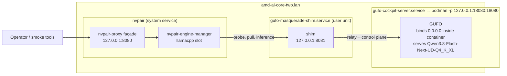

# gufo-masquerade shim — technical documentation

**Version:** 1.1.0 · **Location:** `shim/gufo_masquerade/` · **Deployment node:** `amd-ai-core-two.lan`

The shim makes **GUFO** look like a **llama.cpp router** to nVidia's
**Personal AI Router (PAIR)**. GUFO v0.20.0 deliberately mimics llama-server's
*inference* surface (`/props`, `/slots`, `/completion`, `llamacpp:`-prefixed
Prometheus metrics), but not the llama.cpp **router control plane** that
PAIR's `nvpair-engine-manager` drives for the `llamacpp` engine profile. The
shim is a single-process reverse proxy that closes exactly those gaps and
passes everything else through byte-transparently, including SSE.

---

## 1. Architecture



> [!WARNING]
> **Never change the in-container bind.** GUFO must bind `0.0.0.0` *inside*
> the container — that is how Podman's pasta/slirp networking reaches it.
> Loopback lockdown is achieved with the **port mapping**
> (`-p 127.0.0.1:18080:18080`), not with the bind address. Changing the bind
> to `127.0.0.1` severs the mapping and takes the model offline.

### Live port map (empirical, this node)

| Component | Address | Notes |
|---|---|---|
| PAIR proxy façade | `127.0.0.1:8080` | PAIR's own nvpair-proxy |
| **Shim** (llamacpp slot) | `127.0.0.1:8081` | what PAIR probes; user unit `gufo-masquerade-shim.service` |
| **GUFO** | `127.0.0.1:18080` | user unit `gufo-cockpit-server.service` (podman) |
| Halogen rollback target | `:8731` | `halogen-flash-server.service` |

### Package layout

```
shim/
├── gufo_masquerade/            implementation (importable package)
│   ├── config.py               environment parsing → immutable Config
│   ├── errors.py               UpstreamUnavailable + PAIR error envelope
│   ├── inventory.py            virtual model inventory (G4/G6, persisted overlay)
│   ├── sse.py                  ProgressHub + wire-format frames (G5)
│   ├── app.py                  create_app() factory: routes, relay, policy
│   └── __main__.py             uvicorn entrypoint (python -m gufo_masquerade)
├── gufo_masquerade_shim.py     thin launcher — keeps systemd/pairctl paths stable
└── tests/                      unit + contract suites (see §6)
```

`create_app()` is a **factory**, not a module-global app: tests inject a
custom `Config`, an `httpx.AsyncClient` (a `MockTransport` fake GUFO), and
their own `Inventory`/`ProgressHub`. Production instances are built by
`__main__.main()` from the environment alone.

The launcher (`gufo_masquerade_shim.py`) exists because `systemd`
(`ExecStart=.../gufo_masquerade_shim.py`), `gufo-pairctl` (`SHIM_SCRIPT`
default), and `Containerfile.shim` all reference that path. It bootstraps
`sys.path` from its own location so it works with any cwd — including `/`,
which is what systemd gives it. `test_entrypoints.py` runs it as a real
subprocess with `cwd="/"` specifically to guard this.

---

## 2. The gaps it closes (PAIR semantics)

Each gap was identified against the real Go client in `nvpair-engine-manager`
and is asserted in the contract suite against **ports of that Go code**
(`shim/tests/pair_semantics.py`) — a green check means *PAIR's own decoder
accepts the response*, not merely that the status code was 200.

| Gap | Endpoint | Shim behaviour | Why |
|---|---|---|---|
| **G1** | `GET /props` | GUFO body verbatim + `role: "router"` + `masquerade` block | `probe()` does a hard `resolveObjectPath(obj, "role")`; a missing field is `false`, so without this the engine is **never adopted**. |
| **G2** | `POST /models/load` | Idempotent `{"success": true}` for resident models; 404 + `known[]` otherwise | GUFO pre-loads statically. A blind ack would hide a typo until inference failed far from its cause. |
| **G3** | `POST /models/unload` | Download-cancel → `{"success": true}`; evict live model → honest 409 | `stopLlamaCPPDownload` posts unload and **requires** `success:true` for cancels. Acking an evict GUFO cannot perform is a lie that surfaces later as inference from a "gone" model. `SHIM_REFUSE_UNLOAD_SERVING=0` opts into quiet acking. |
| **G4** | `DELETE /models` | Inventory-only delete, **persisted** to `SHIM_STATE_PATH` | GUFO cannot delete weights. Persistence stops a shim restart resurrecting models the operator removed. |
| **G5** | `GET /models/sse` | In-process pub/sub hub; keepalive comments; oldest-drop backpressure | Terminal events are one-shot broadcasts with **no replay**; a wedged subscriber must never stall a publisher. |
| **G6** | `GET /models` | Every row gains `status.value`/`status.normalized` | PAIR's `models_dir` filter `status.value in ["loaded"]` drops rows without it — the UI would show zero models on a healthy node. |
| **G7** | `POST /v1/embeddings`, `/v1/rerank`, `/rerank`, `/infill` | Local 501, fast, attributed | Never opens a GPU slot; a sub-second 501 beats a connection that hangs until the router times out. |
| **G8** | `POST /models` | `present-ok` \| `fake` \| `reject` policy | GUFO has no HTTP weight provisioning. `present-ok` (default) acks resident models with 202 + terminal SSE frames so PAIR's handshake completes instead of timing out. |
| — | everything else | Byte-transparent streaming passthrough, O(1) memory | `aiter_raw` + `StreamingResponse`; inference is not the shim's business. |

### Protocol-fidelity rules (the ones that bit us)

1. **Honesty under dead upstream.** PAIR adopts anything answering `/props`
   200 with `role=router` and routes work to any node answering `/health`
   200. Every readiness-bearing handler therefore converts
   `UpstreamUnavailable` into 502/503. A happy lie creates a "ready" node
   that fails every request silently.
2. **`success` must be an explicit boolean.** PAIR's Go decoders treat a
   *missing* `success` key as `nil` and abort. Every response — success or
   error — carries it.
3. **Probe header stripped.** PAIR stamps probes with
   `X-NVPAIR-Engine-Identity-Probe: 1`; GUFO must not see it
   (`forward_headers`).
4. **Credential direction.** PAIR sends **nothing** to the llamacpp slot;
   the shim injects GUFO's bearer token (`GUFO_API_KEY`) on every upstream
   call and *discards* any inbound `Authorization`. This is why the shim's
   own bind must remain loopback-only.
5. **Subscribe-before-POST.** `pullModelLlamaCPPSSE` subscribes to
   `/models/sse` before issuing `POST /models`; terminal frames are
   published *before* the 202 ack returns, into queues that already exist.
6. **Header hygiene.** `Content-Length`/`Transfer-Encoding`/`Date`/`Server`
   are stripped from relayed responses (they become lies once we re-frame,
   e.g. upstream-200 → shim-502); `X-Accel-Buffering: no` is added so an
   intermediary never buffers an SSE stream into a blob.

### SSE wire format (pinned to `pull.go` `llamaCPPModelsEvent`)

```
data: {"model": "<id>", "event": "download_progress",
       "data": {"progress": {"model.gguf": {"done": 123, "total": 1000}}}}
```

PAIR computes percent as `sum(done)/sum(total)` across the progress map and
drops frames whose `model` ≠ the watched id.

---

## 3. Configuration (environment only)

| Variable | Default | Meaning |
|---|---|---|
| `SHIM_HOST` | `127.0.0.1` | Bind address. **Keep loopback**; the shim holds GUFO's credential. |
| `SHIM_PORT` | `8081` | PAIR's reserved llamacpp slot. |
| `GUFO_BASE_URL` | `http://127.0.0.1:18080` | Upstream (no trailing slash needed). |
| `GUFO_API_KEY` | *(empty)* | Bearer token injected upstream. GUFO on this node runs keyless on loopback; empty = no auth headers. |
| `SHIM_ROUTER_ROLE` | `router` | Value PAIR's matcher requires; only change for a different manifest. |
| `SHIM_PULL_POLICY` | `present-ok` | `present-ok` \| `fake` \| `reject`. Unknown values abort startup. |
| `SHIM_REFUSE_UNLOAD_SERVING` | `1` | 409 on unload/delete of the served model (honest default). |
| `SHIM_STATE_PATH` | `/var/lib/gufo-masquerade/state.json` | Persisted deleted-model overlay. |
| `SHIM_CONNECT_TIMEOUT_S` | `5` | Upstream connect timeout. |
| `SHIM_DISCOVERY_TIMEOUT_S` | `10` | Read timeout for `/props`, `/models`, `/health` probes. |
| `SHIM_READ_TIMEOUT_S` | `1800` | Read timeout for relayed inference. |
| `SHIM_INVENTORY_TTL_S` | `2` | How long a cached GUFO `/models` may be trusted. |
| `SHIM_SSE_KEEPALIVE_S` | `5` | Idle SSE keepalive comment interval. |
| `SHIM_FAKE_BYTES` / `SHIM_FAKE_TICKS` / `SHIM_FAKE_TICK_MS` | `4e9` / `10` / `200` | Synthetic-download shape (`fake` policy; `present-ok` uses `SHIM_FAKE_BYTES` as the reported size of an already-resident model). |
| `SHIM_LOG_LEVEL` | `info` | Python + uvicorn level. |
| `SHIM_ACCESS_LOG` | `0` | Off by default — PAIR polls every 5s. |

Bad integers/policies **crash at startup** with the variable named; systemd
restarts and the operator sees why. This is deliberate: a typo'd timeout
silently reverting to a default is worse.

---

## 4. Deployment state on `amd-ai-core-two`

Host-native (NOT compose), per the repair of 2026-11-03:

* `/usr/local/lib/gufo-masquerade/` — **must contain both**
  `gufo_masquerade_shim.py` *and* the `gufo_masquerade/` package dir.
* `/etc/gufo-pair/env` — `GUFO_BASE_URL=http://127.0.0.1:18080`,
  `SHIM_BIND=127.0.0.1`, `SHIM_PORT=8081`,
  `SHIM_STATE_PATH=/var/lib/gufo-masquerade/state.json`,
  `SHIM_REFUSE_UNLOAD_SERVING=1`, `SHIM_PULL_POLICY=present-ok`.
* user unit `gufo-masquerade-shim.service` (enabled, `Restart=always`),
  supervised by `gufo-pairctl` rev2, which waits on
  `gufo-cockpit-server.service` and **never starts a second GUFO** (125 GiB
  box, ~105 GiB resident — a duplicate GUFO is instant OOM).
* PAIR override at
  `~/.config/Nvidia Corporation/Personal AI Router/engines/llamacpp.json`;
  apply with `sudo systemctl restart nvpair.service`.

Deploying a new shim revision (after this change set):

```bash
# from the repo checkout on the node
sudo cp -a shim/gufo_masquerade /usr/local/lib/gufo-masquerade/
sudo cp -a shim/gufo_masquerade_shim.py /usr/local/lib/gufo-masquerade/
systemctl --user restart gufo-masquerade-shim.service
```

`ops/deploy_stack.sh` stages both artifacts; `Containerfile.shim` copies both
into the image (v1.1.0).

---

## 5. Verifying the shim

### 5.1 Unit suite (no ports, no model, seconds)

```bash
cd shim
python3 -m venv .venv && .venv/bin/pip install -r requirements.txt pytest coverage
.venv/bin/python tests/run_unit_tests.py            # 113 tests
.venv/bin/coverage run tests/run_unit_tests.py && .venv/bin/coverage report -m
```

Current status: **113 tests, 100% statement coverage** of
`gufo_masquerade/` (incl. `__main__`; the launcher's `__main__` guard is
pragma-excluded and instead executed as a real subprocess from `cwd=/`).
Where pytest works, `pytest shim/tests` runs the identical classes; on the
deployment nodes pytest is killed by the sandbox seccomp filter (SIGSYS), so
`run_unit_tests.py` (stdlib `unittest`) is the primary runner.

### 5.2 Contract suite (mock GUFO + PAIR decoder ports)

```bash
.venv/bin/python tests/run_contract_checks.py     # 33 checks
```

Spawns `mock_gufo.py` (GUFO v0.20.0 mirror: no `role`, no `status`, Bearer
auth) and a real shim subprocess, then runs every check through the Go-ported
matchers in `pair_semantics.py` (probe gate, start-ack gate, SSE percent
decoder, pull state machine, `models_dir` filter).

### 5.3 Live node checks

```bash
curl -fsS localhost:8081/props | python3 -m json.tool | grep -m1 '"role"'
# "role": "router"   ← PAIR adoption gate

curl -fsS localhost:8081/health
# {"status":"ok","engine":"gufo",...,"upstream":{"status":"ok"}}

curl -fsS localhost:8081/models | head -c 400
# rows carry "status": {"value": "loaded", ...}

curl -fsS localhost:8081/shim/config      # redacted runtime config
curl -fsS localhost:8081/shim/state       # deleted[] + overlay{}
curl -fsS localhost:8081/shim/sse_stats   # live SSE subscribers

# inference through the shim:
curl -N -s localhost:8081/v1/chat/completions -H 'content-type: application/json' \
  -d '{"model":"Qwen3.8-Flash-Next-UD-Q4_K_XL","messages":[{"role":"user","content":"hi"}],"stream":true}' | head

# off-host lockdown (must FAIL from any other machine):
# curl http://amd-ai-core-two.lan:8081/props   → connection refused
```

`ops/smoke_pair_facade.sh --direct` runs the cutover gate end-to-end.

### 5.4 Negative checks worth running by hand

| Check | Command | Expected |
|---|---|---|
| Dead GUFO ≠ ready | `systemctl --user stop gufo-cockpit-server; curl -s -o /dev/null -w '%{http_code}' localhost:8081/props` | `502` (never 200) |
| Control surface survives | `curl -s localhost:8081/shim/config` (GUFO still stopped) | 200 |
| Live unload refused | `curl -s -X POST localhost:8081/models/unload -H 'content-type: application/json' -d '{"model":"Qwen3.8-Flash-Next-UD-Q4_K_XL"}'` | 409 + explanation |
| Embeddings fail fast | `time curl -s -o /dev/null -X POST localhost:8081/v1/embeddings` | 501 in ms, `unsupported_task` |

Restore with `systemctl --user start gufo-cockpit-server` afterwards.

---

## 6. Test map

| File | Level | Covers |
|---|---|---|
| `tests/test_config.py` | unit | env parsing edge cases, defaults, redaction |
| `tests/test_inventory.py` | unit | upstream error taxonomy, caching/TTL, overlay persistence, enrichment |
| `tests/test_sse_hub.py` | unit | pub/sub, wildcard, dedup, backpressure drop policy |
| `tests/test_app.py` | unit + real uvicorn | every route + policy branch, header fidelity, relay, SSE over sockets |
| `tests/test_entrypoints.py` | unit + subprocess | launcher bootstrap from `cwd=/`, `main()` uvicorn contract, owned-client lifecycle |
| `tests/test_pair_contract.py` + `contract_checks.py` | contract | the whole surface against Go-ported PAIR matchers |
| `tests/unit_support.py`, `pair_semantics.py`, `mock_gufo.py` | harness | fakes and decoder ports |

---

## 7. Operational notes & gotchas

* **SMB `/workspace` quirk:** `sed -i` throws `Bad system call` on this mount
  and leaves `sedXXXXXX` strays — edit with Python or `patch`, not `sed -i`.
* **State file**: losing `/var/lib/gufo-masquerade/state.json` only forgets
  which models PAIR deleted; the shim boots clean and logs a warning if it's
  corrupt. It never contains secrets.
* **Two shim revisions must not overlap on :8081** — `gufo-pairctl status`
  shows what owns it. (The original outage was a stock `llama-server`
  silently occupying the slot.)
* **Do not "fix" the GUFO bind.** See the warning in §1. Lockdown lives in
  the podman port mapping and, for the shim, in `SHIM_HOST=127.0.0.1`.
* **Version drift**: bump `DEFAULT_VERSION` in `config.py` together with the
  `SHIM_IMAGE` tag in `ops/env.sample` and `Containerfile.shim`.
